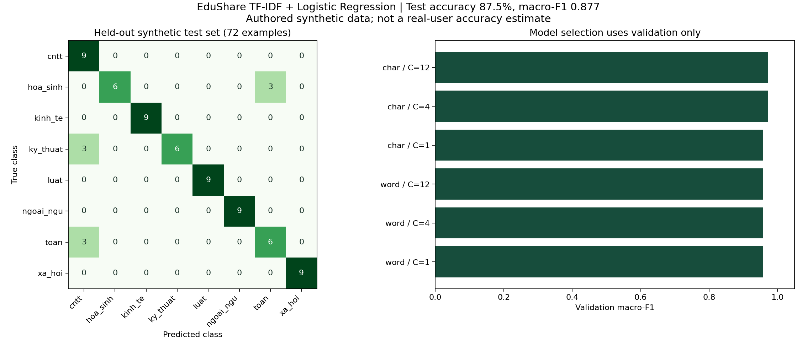
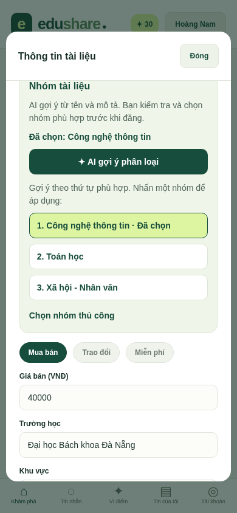

# AI phân loại tài liệu EduShare

## Chức năng đã tích hợp

Trong Đăng/Sửa tài liệu, nhập tên và mô tả, nhấn **AI gợi ý phân loại**. App hiển thị ba nhóm tham khảo theo thứ tự điểm mô hình. Người đăng nhấn nhóm để áp dụng hoặc mở **Chọn nhóm thủ công**. AI không tự thay môn học hoặc tự lưu tin. Có thể giữ Chưa phân loại và đăng bình thường.

Tám nhóm: Công nghệ thông tin; Toán học; Ngoại ngữ; Kinh tế - Quản trị; Vật lý - Kỹ thuật; Hóa học - Sinh học; Pháp luật; Xã hội - Nhân văn. Đây là nhóm rộng, không phải mô hình nhận diện chính xác tên từng học phần. Chưa phân loại là trạng thái do người dùng chọn, không phải lớp thứ chín được huấn luyện.

AI chỉ đọc tên và mô tả được gửi khi nhấn nút; không đọc ảnh, PDF, chat, email hay số điểm. Không sử dụng LLM hoặc dịch vụ AI bên ngoài. Hộp hỗ trợ FAQ là tính năng riêng, không được gọi là mô hình phân loại này.

## Dùng ngay trên Windows / VS Code

Mô hình **đã huấn luyện** được lưu trong Git dưới dạng trọng số JSON. API Node.js thực hiện suy luận ngay trong tiến trình đang có. Không cần Python, GPU, API key hoặc server AI riêng để dùng app.

Dừng API/Expo cũ bằng Ctrl+C, tại thư mục gốc:

```powershell
cd D:\EDUSHARE\AppEduShare
git pull --ff-only
npm.cmd ci
npm.cmd run db:migrate
npm.cmd run api
```

Giữ PostgreSQL đang chạy. Terminal thứ hai:

```powershell
cd D:\EDUSHARE\AppEduShare
npm.cmd run android -w apps/mobile -- --clear
```

Migration v3 thêm category vào listings và bảng ai_classifications, giữ nguyên dữ liệu cũ. Không seed/import/reset database hiện có. API cũng tự migrate khi khởi động.

Ví dụ demo: tên **Giáo trình Java và lập trình hướng đối tượng**, mô tả **Class, kế thừa, interface và bài tập viết chương trình Java.** → AI gợi ý Công nghệ thông tin. Chọn áp dụng rồi lưu; mở chi tiết để xem nhóm đã lưu. Đổi sang nhóm khác để minh họa người dùng có quyền sửa kết quả.

## Dữ liệu và giới hạn nguồn

- `ai/data/topics.json`: 160 chủ đề do trợ lý biên soạn, 20 chủ đề/nhóm; không thu thập từ tin đăng thật hay chép nội dung sách.
- `ai/build_demo_data.py`: tạo ba biến thể tên/mô tả cho mỗi chủ đề, có thông tin giao nhận trung tính.
- `ai/data/documents.csv`: **480 mẫu tổng hợp**, trường id, group, split, title, description, category, source. Mỗi nhóm có60 mẫu. Source là `authored_synthetic_demo`.
- Các biến thể cùng chủ đề luôn nằm cùng một tập. Mỗi nhóm chia14 chủ đề train, 3 validation, 3 test: tổng **336/72/72 mẫu**, tương ứng112/24/24 nhóm chủ đề. Seed2026 cố định.
- Kiểm tra không giao nhau về group và toàn bộ văn bản đã chuẩn hóa. Tuy nhiên các tập vẫn dùng cùng cách biên soạn/template và có từ ngữ cùng miền; đây là giới hạn của dữ liệu demo, không tương đương bộ kiểm thử người dùng độc lập.

Không ghi “huấn luyện trên dữ liệu sinh viên thực tế” hoặc suy ra độ chính xác vận hành từ tập này. Bộ dữ liệu nhỏ có thể thiên lệch, thiếu ngành học và chưa đánh giá tốt tài liệu đa lĩnh vực. Người dùng cần xác nhận kết quả.

## Mô hình và quy trình huấn luyện

1. Chuẩn hóa chữ thường, bỏ dấu tiếng Việt, chuyển đ thành d, thay ký tự ngoài a-z/0-9 bằng khoảng trắng. Đầu vào là `tên + tên + mô tả` để tăng trọng số tên.
2. So sánh TF-IDF từ1–2 gram và ký tự3–5 gram, min_df2, tối đa30.000 đặc trưng, sublinear TF và chuẩn L2. Vocabulary/IDF chỉ được học từ train.
3. Huấn luyện multinomial Logistic Regression với C thuộc1,4,12; solver LBFGS, max_iter2000. Chọn cấu hình theo macro-F1 trên validation; hòa điểm giữ cấu hình xét trước. Không fit lại trên validation/test.
4. Chọn ngưỡng gợi ý trên validation: điểm top1 và chênh lệch top1-top2. Điểm softmax không phải xác suất đúng đã được hiệu chuẩn.
5. Sau khi cố định mô hình/ngưỡng mới đánh giá test. Xuất vocabulary, IDF, hệ số và intercept thành JSON; không cần chạy Python trong app.
6. Kiểm thử Node.js so sánh mọi điểm dự đoán với scikit-learn trên79 fixture:72 mẫu test và7 ca bổ sung, gồm tiếng Việt không dấu/Unicode/nội dung mơ hồ. Sai lệch cho phép dưới1e-8.

## Kết quả đo được trên dữ liệu tổng hợp

| Chỉ số | Kết quả |
| --- | --- |
| Cấu hình được chọn | TF-IDF ký tự3–5 + Logistic Regression, C=4 |
| Macro-F1 validation | 0,9712 |
| Accuracy test top1, tính trên toàn bộ72 mẫu | **0,8750 (63/72)** |
| Macro-F1 test top1, toàn bộ72 mẫu | **0,8771** |
| Ngưỡng điểm / chênh lệch | 0,35 / 0,10 |
| Mẫu test đủ ngưỡng đưa gợi ý chính | 32/72, coverage44,44% |
| Đúng trong số32 mẫu đủ ngưỡng | 32/32; cỡ mẫu nhỏ, không phải cam kết100% |
| Mẫu chưa đủ chắc chắn | 40/72; app đề nghị chọn thủ công hoặc nhóm tham khảo |

Chín dự đoán top1 sai nằm ở các chủ đề Toán rời rạc, Kết cấu xây dựng và Hóa phân tích (mỗi chủ đề3 biến thể). Những lỗi này được giữ nguyên trong báo cáo, không sửa dữ liệu/nhãn test để nâng điểm. Ví dụ Hóa phân tích có từ “phân tích/định lượng” dễ lẫn với Toán; tên ngắn, chủ đề mới cần thêm dữ liệu thực tế.

Kết quả đầy đủ: [metrics.json](../ai/reports/metrics.json), [từng dự đoán test](../ai/reports/test-predictions.json).



## Tự huấn luyện lại

Chỉ bước huấn luyện cần **Python3.12**. Không cần kích hoạt môi trường ảo trong PowerShell:

```powershell
cd D:\EDUSHARE\AppEduShare
py -3.12 -m venv .venv
.\.venv\Scripts\python.exe -m pip install -r ai/requirements.txt
.\.venv\Scripts\python.exe ai/train.py
.\.venv\Scripts\python.exe ai/train.py --verify
.\.venv\Scripts\python.exe ai/plot_report.py
npm.cmd test
```

`train.py` học từ CSV hiện có, xuất model/parity/metrics/test-predictions. `--verify` huấn luyện lại, so sánh trọng số và kết quả với artifact đã lưu, không ghi đè. Khởi động lại API để nạp model mới. `plot_report.py` cập nhật hình, không huấn luyện.

`build_demo_data.py` **ghi đè CSV bằng dữ liệu demo**; chỉ chạy khi muốn tái tạo đúng bộ demo, không chạy sau khi bổ sung dữ liệu thực.

Để cải thiện: thu thập tên/mô tả tài liệu được phép sử dụng, gán nhãn bằng người hiểu môn học, giữ id/group/split/source và kiểm tra lại. Các bản trùng/gần trùng, cùng đầu sách hoặc cùng nguồn nên ở cùng một group. Dùng test độc lập, không thay test sau mỗi lần xem lỗi; khi đã dùng lỗi test để chỉnh mô hình cần một test mới. Sau khi thay CSV phải train/export lại rồi chạy tests. Mức1.000–3.000 mẫu thực là hướng phát triển, **chưa có trong phiên bản này**.

## Lưu database và phản hồi

- `listings.category`: ID nhóm cuối do người đăng chọn; tin cũ mặc định chuỗi rỗng.
- `ai_classifications`: người yêu cầu, SHA-256 của cặp tên/mô tả, phiên bản model, top3, nhóm dự đoán (NULL nếu abstain), nhóm xác nhận và listing_id sau khi lưu. Không lưu riêng nội dung bản nháp trong bảng AI.
- Chỉ được gắn gợi ý của chính tài khoản, chưa dùng và có đầu vào trùng. Đổi tên/mô tả sẽ bỏ kết quả cũ ở UI; server cũng kiểm tra để chặn phản hồi cũ.
- Lưu tin/nhóm/phản hồi trong cùng transaction. Thiếu AI hoặc không dùng AI vẫn đăng/sửa được; client cũ không gửi category khi sửa vẫn giữ nhóm hiện có.
- Gợi ý chưa gắn tin quá30ngày được dọn khi chính người đó yêu cầu AI tiếp theo. Nhóm xác nhận là phản hồi của người dùng, **chưa phải nhãn chuẩn**. Không tự đưa phản hồi vào huấn luyện; cần rà soát quyền sử dụng và nhãn trước.

## File triển khai

| File | Vai trò |
| --- | --- |
| ai/categories.json | Danh mục dùng chung giữa Python, Node và Expo |
| ai/train.py | Huấn luyện, chọn mô hình/ngưỡng, đánh giá và export |
| ai/artifacts/model.json | Trọng số đã học, dùng khi chạy API |
| ai/artifacts/parity.json | Fixture so sánh Python/Node |
| server/src/classifier.js | TF-IDF, softmax, abstention và gắn phản hồi |
| server/migrations/003-document-classifier.sql | Nhóm tài liệu và bảng phản hồi |
| apps/mobile/components/AiSuggestion.tsx | Gợi ý, xác nhận, chọn thủ công, bỏ phản hồi cũ |
| server/test/classifier.test.js | Parity, tiếng Việt không dấu, ca mơ hồ |

API: GET `/api/ai/categories` công khai; POST `/api/ai/classify` cần đăng nhập, body `{title,description}`, tối đa10lần/phút/IP. Client không được gửi trọng số hay ép nhãn dự đoán. Xem thêm [API.md](API.md).

## Minh chứng giao diện

Ảnh từ web chạy thật, không phải nghiệm thu thiết bị native:



## Nội dung có thể trình bày khi bảo vệ

“Đồ án có mô hình học máy có giám sát để gợi ý nhóm tài liệu từ tên và mô tả. Em dùng TF-IDF và Logistic Regression, tách train/validation/test theo nhóm chủ đề, chọn cấu hình bằng validation và đo Accuracy/Macro-F1 trên test. Mô hình đã được huấn luyện trên480 mẫu tổng hợp cho bản thử nghiệm, đạt63/72 mẫu test top1. Khi điểm thấp hệ thống không tự chốt nhóm; người đăng xác nhận hoặc sửa. Đây chưa phải kết quả đánh giá dữ liệu người dùng thực tế.”
