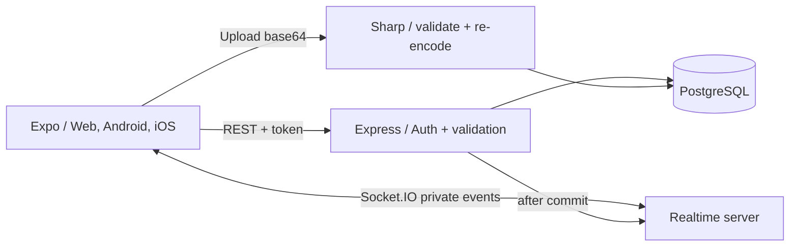
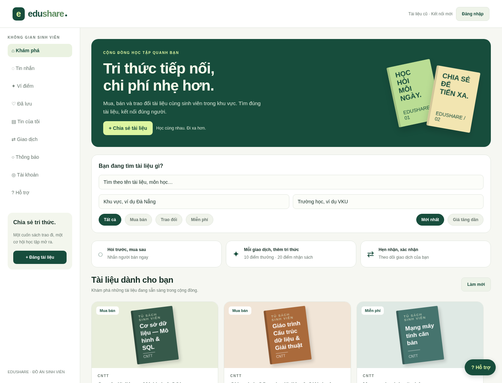
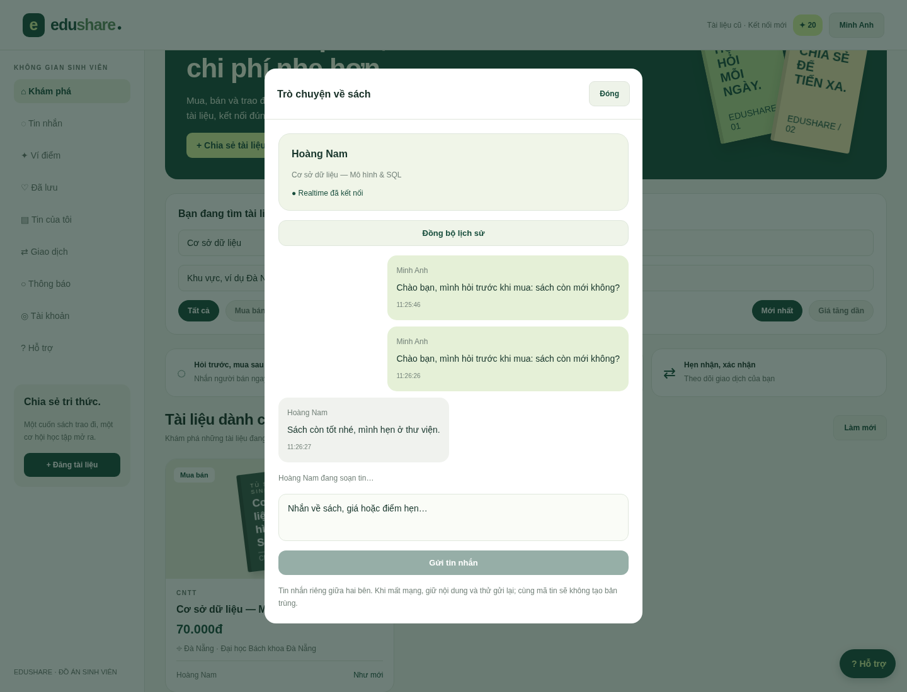
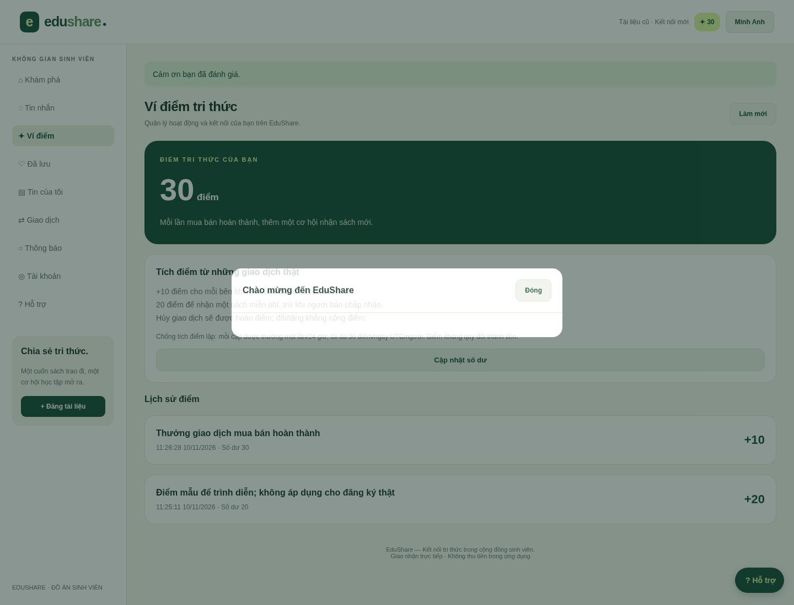
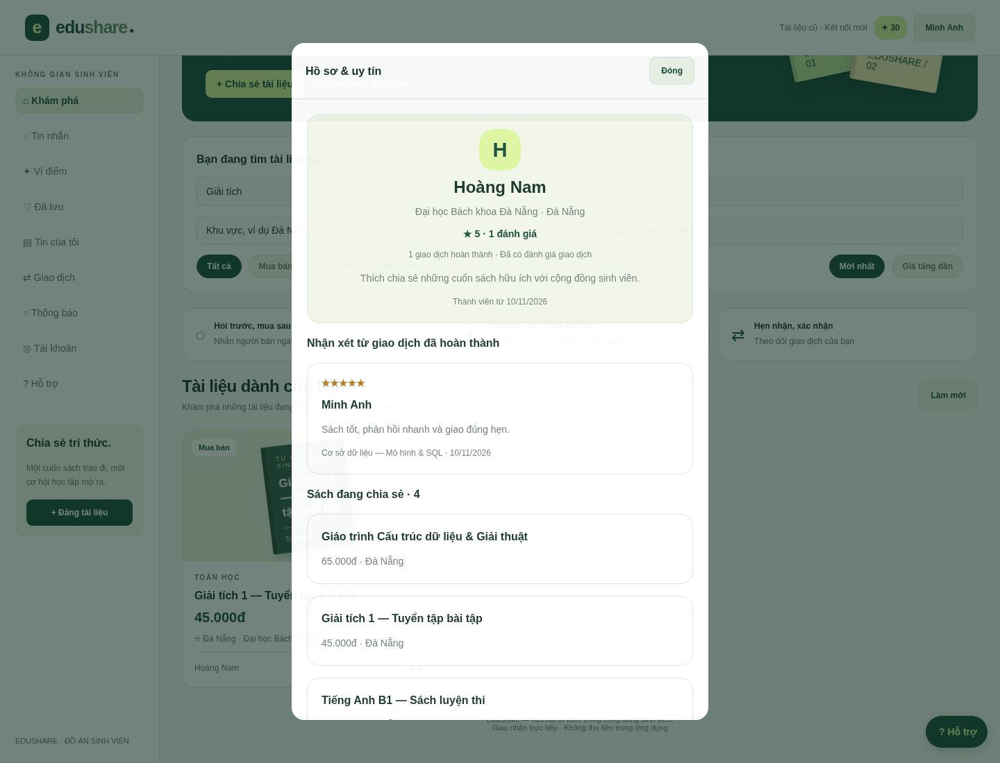
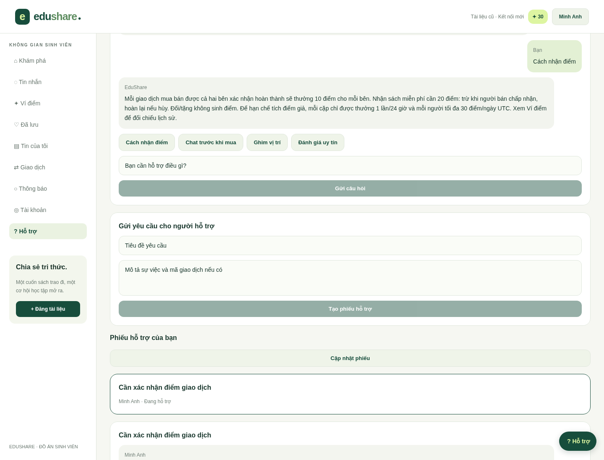
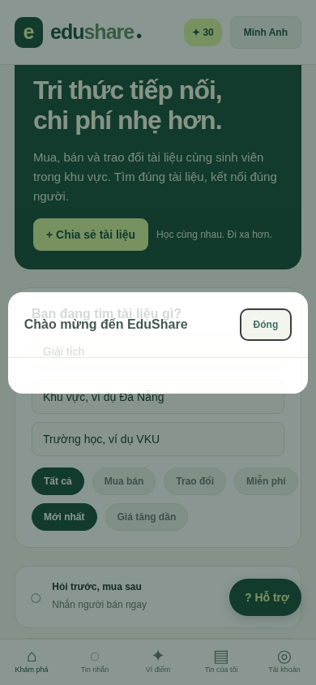
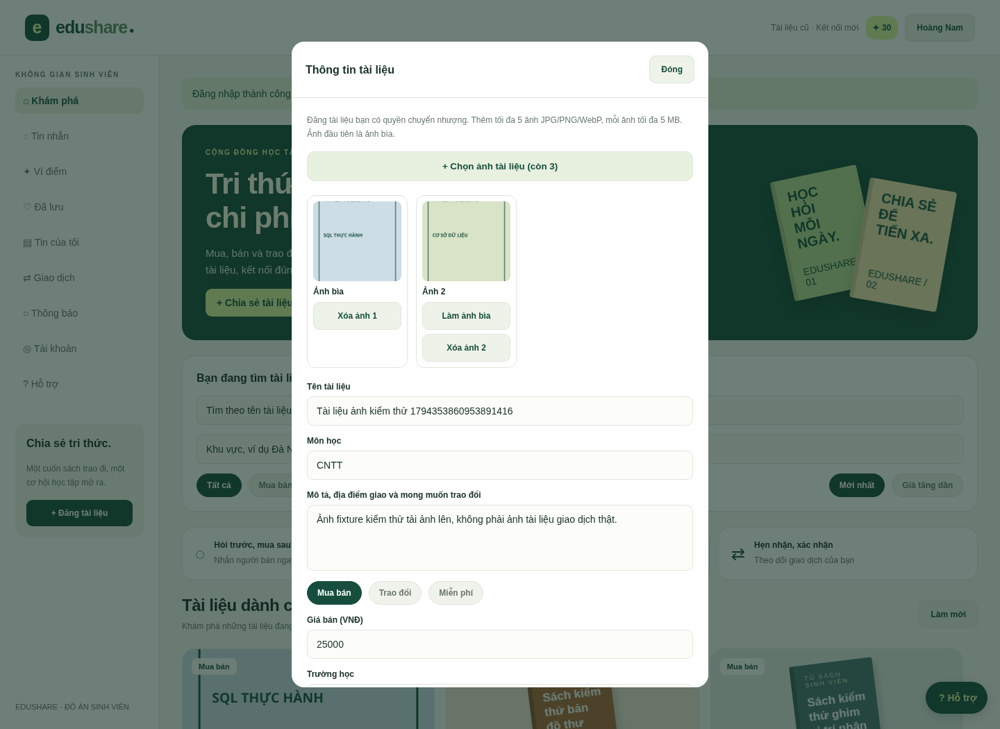
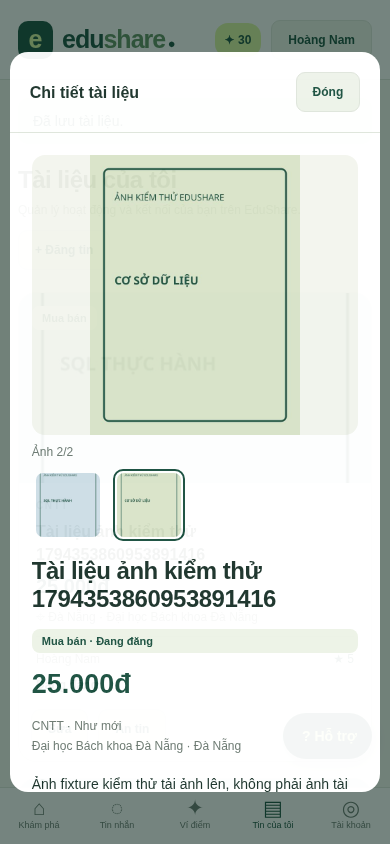

# BÁO CÁO ĐỒ ÁN — EDUSHARE 2

## XÂY DỰNG ỨNG DỤNG ĐA NỀN TẢNG HỖ TRỢ MUA BÁN VÀ TRAO ĐỔI TÀI LIỆU HỌC TẬP CHO SINH VIÊN TRONG KHU VỰC

- Trường/Khoa: [Điền theo đơn vị đào tạo]
- Sinh viên: [Họ tên] — Mã sinh viên: [Mã sinh viên] — Lớp: [Lớp]
- Giảng viên hướng dẫn: [Họ tên] — Học phần: [Học phần]
- Phiên bản: 2.0 — cập nhật ảnh tài liệu 11/11/2026
- Mã nguồn: https://github.com/TanTai08/AppEduShare

Thông tin cá nhân chưa được cung cấp nên để trống. Người nộp cần rà soát quy định trình bày và học thuật của trường, bổ sung phần công việc cá nhân thực tế và kết quả chạy trên thiết bị của mình.

## TÓM TẮT

EduShare 2 hỗ trợ sinh viên mua bán, trao đổi và nhận tài liệu bản giấy trong cùng trường hoặc khu vực. Từ bản MVP cục bộ, hệ thống được chuyển sang PostgreSQL và bổ sung chat realtime trước khi mua, ví điểm, ảnh tài liệu, điểm hẹn dạng văn bản, hồ sơ uy tín và hộp hỗ trợ. Giao diện sử dụng Expo SDK58/React Native/TypeScript, backend dùng Node.js/Express và Socket.IO.

Trọng tâm kỹ thuật là bảo toàn trạng thái tài liệu, giao dịch và số dư khi nhiều người thao tác đồng thời. Giao dịch hoàn thành cần xác nhận hai phía; điểm được cập nhật cùng sổ ledger trong transaction; sự kiện realtime phát sau commit. Cuộc trò chuyện độc lập với đơn mua nên hai bên có thể hỏi tình trạng và thương lượng trước. Dữ liệu SQLite cũ có công cụ chuyển sang PostgreSQL chỉ đọc, không xóa nguồn.

Kết quả gồm mã nguồn, schema/migration, dữ liệu mẫu, kiểm thử HTTP/socket/database/import, ảnh giao diện và tài liệu vận hành. Phạm vi chưa bao gồm xác thực thanh toán/giao nhận ngoài đời, vận hành nhiều Node instances, tải file số, AI sinh hoặc push khi app đóng. Kết quả bundling native không thay thế nghiệm thu trên Android/iPhone thật.

## MỤC LỤC

1. Tổng quan đề tài
2. Cơ sở công nghệ và lựa chọn PostgreSQL
3. Phân tích yêu cầu
4. Thiết kế dữ liệu và nghiệp vụ
5. Cài đặt giao diện và dịch vụ
6. Kiểm thử và đánh giá
7. Chuyển đổi, triển khai và vận hành
8. Kết luận và hướng phát triển
9. Tài liệu tham khảo và phụ lục

## CHƯƠNG 1. TỔNG QUAN ĐỀ TÀI

### 1.1. Bài toán

Tài liệu đã dùng thường còn giá trị với sinh viên khóa sau. Tin đăng rải rác trong nhóm chat khó lọc theo trường, môn, giá và khu vực. Người mua cần hỏi tình trạng trước khi quyết định; người bán cần tránh giữ cùng một cuốn cho nhiều người. Khi giao dịch ngoài đời, hai bên cũng cần điểm hẹn và lịch sử trao đổi có thể xem lại.

Hệ thống tập trung thông tin tài liệu, liên hệ trước mua và quản lý trạng thái. Điểm thưởng khuyến khích hoạt động mua bán đã được hai bên xác nhận, sau đó có thể dùng để nhận sách miễn phí trong cộng đồng. Đánh giá gắn giao dịch tạo tín hiệu uy tín, nhưng không được coi là bảo đảm thanh toán hoặc xác minh danh tính. Báo cáo không đưa ra tỷ lệ tiết kiệm hay mức hài lòng vì chưa có khảo sát người dùng thật.

### 1.2. Mục tiêu và phạm vi

- Giao diện dùng chung cho web, Android và iOS; bố cục tiếng Việt thích ứng màn hình.
- Tìm kiếm, đăng tin, mua/đổi và nhận sách bằng điểm.
- Chat riêng realtime trước và sau khi gửi yêu cầu mua.
- Chọn ảnh, xem trước, đổi ảnh bìa và ghi điểm giao nhận công khai bằng văn bản.
- Xem hồ sơ, sao, nhận xét từ các giao dịch hoàn thành.
- FAQ hỗ trợ tự động và phiếu riêng cho quản trị viên.
- Chuyển dữ liệu SQLite sang PostgreSQL và kiểm thử các bất biến quan trọng.

Phiên bản này giao nhận trực tiếp, không thu hoặc giữ tiền trong ứng dụng. Tài liệu là bản giấy được phép chuyển nhượng; không cung cấp tải PDF. Tài khoản có trường/khu vực do người dùng khai báo, chưa xác minh sinh viên qua trường hoặc email.

### 1.3. Phương pháp

Thiết kế theo luồng end-to-end: yêu cầu → API → database → giao diện → kiểm thử. Quy tắc quan trọng được bảo vệ ở server/database. Các phần mới có kiểm thử kết quả quan sát được: quyền chat, cạnh tranh giữ chỗ, không đủ điểm, hoàn điểm, đánh giá và chuyển đổi dữ liệu. Không suy ra hiệu năng quy mô lớn từ kết quả chạy thử cục bộ.

## CHƯƠNG 2. CƠ SỞ CÔNG NGHỆ

### 2.1. React Native, Expo và TypeScript

React Native cập nhật giao diện theo component/state và cung cấp khả năng dùng chung mã cho nhiều nền tảng. Expo SDK58 được chọn để tương thích Expo Go SDK58 trên iPhone. React Native Web hiển thị cùng thành phần trong trình duyệt; TypeScript kiểm tra kiểu dữ liệu trước khi chạy. Safe Area xử lý vùng tai thỏ/thanh home thay cho khoảng đệm cố định.

React không đồng nghĩa với reactive streams hoặc RxJS. Dự án sử dụng hooks, REST bất đồng bộ và sự kiện Socket.IO; không trình bày đây là backend reactive streams.

### 2.2. Node.js, Express và Socket.IO

Express tổ chức API JSON, Zod kiểm tra dữ liệu, middleware xác thực/phân quyền bảo vệ tài nguyên. Socket.IO quản lý kết nối realtime, reconnect và sự kiện. Ghi tin nhắn vẫn đi qua REST để có validation/idempotency nhất quán; sau commit server đẩy tới room người nhận. Client không được tự chọn room user khác.

Node 24 chạy API và công cụ chuyển đổi SQLite. Mật khẩu băm scrypt bất đồng bộ. Token phiên ngẫu nhiên lưu hash và hạn dùng; logout thu hồi phiên và ngắt socket tương ứng. Web lưu token trong sessionStorage để demo; native dùng SecureStore. Khi production cần xem xét cookie HttpOnly cho web và chính sách phiên phù hợp.

### 2.3. Vì sao chuyển PostgreSQL

Bản đầu dùng SQLite để dễ chạy đồ án mà không cài dịch vụ database. Khi thêm ví điểm và realtime, hệ thống cần pool kết nối, transaction giữa nhiều thực thể, khả năng quản lý database riêng và công cụ vận hành. PostgreSQL phù hợp mô hình quan hệ giữa người dùng, tin đăng, giao dịch, ledger và đánh giá.

| Tiêu chí         | SQLite bản đầu         | PostgreSQL bản mới                            |
| ---------------- | ---------------------- | --------------------------------------------- |
| Cài đặt          | File cục bộ            | Dịch vụ riêng hoặc Docker                     |
| Truy cập         | API một instance       | Pool kết nối, nhiều kết nối đồng thời         |
| Bảo toàn dữ liệu | Transaction/constraint | Transaction/constraint, row và advisory locks |
| Vận hành         | Sao lưu file nhất quán | pg_dump, pgAdmin, quyền DB, volume            |
| Mục tiêu         | Demo nhanh             | Phát triển backend quan hệ thực tế hơn        |

Không cho điện thoại truy cập PostgreSQL trực tiếp. Connection string chỉ ở backend. PostgreSQL không tự làm chat realtime; cần Socket.IO hoặc cơ chế đẩy khác.

### 2.4. Chọn và xử lý ảnh tài liệu

Native dùng Expo ImagePicker, web dùng file input để chọn tối đa5 ảnh tĩnh JPG/PNG/WebP, mỗi ảnh tối đa5MB. Người đăng xem trước, xóa và chọn ảnh bìa trước khi lưu tin. Server kiểm tra signature/giải mã bằng Sharp, giới hạn25megapixel, chuẩn hóa hướng, bỏ EXIF/GPS và nén thành JPEG tối đa1600px cùng thumbnail480px.

Ảnh lưu BYTEA trong PostgreSQL để triển khai và sao lưu cùng dữ liệu đồ án. Khi mở rộng cần đo tải và cân nhắc object storage/CDN. Ảnh nháp chỉ chủ đọc được; ảnh đã gắn tin công khai qua URL kể cả tin ẩn. UI bản đồ/WebView đã được gỡ do dịch vụ tiles công cộng chặn truy cập. Điểm giao nhận dùng tên nơi công cộng và thỏa thuận qua chat.

## CHƯƠNG 3. PHÂN TÍCH YÊU CẦU

### 3.1. Tác nhân

| Tác nhân  | Quyền                                                                       |
| --------- | --------------------------------------------------------------------------- |
| Khách     | Tìm/xem sách, hồ sơ public và hỏi FAQ                                       |
| Sinh viên | Hồ sơ riêng, tin đăng, chat, giao dịch, ví điểm, đánh giá, báo cáo và phiếu |
| Quản trị  | Chức năng sinh viên, kiểm duyệt, audit và xử lý phiếu                       |

Đăng ký không nhận role hoặc points từ client. Các tài khoản demo/admin chỉ do seed trong môi trường phát triển tạo.

### 3.2. Yêu cầu chức năng

| Mã   | Chức năng         | Tiêu chí                                                 |
| ---- | ----------------- | -------------------------------------------------------- |
| FR01 | Xác thực/hồ sơ    | Email duy nhất, phiên có hạn, sửa hồ sơ của mình         |
| FR02 | Tin đăng/tìm kiếm | Bán/đổi/free, lọc trường/khu vực, trạng thái rõ          |
| FR03 | Chat trước mua    | Không cần tạo transaction; chỉ hai bên đọc/ghi           |
| FR04 | Realtime          | Tin mới, typing, chưa đọc, reconnect và lịch sử          |
| FR05 | Giao dịch         | Giữ chỗ nguyên tử, cả hai xác nhận mới hoàn thành        |
| FR06 | Điểm              | +10 mỗi bên, -20 nhận free, refund, chống xử lý lặp      |
| FR07 | Ảnh và điểm nhận | Tối đa5 ảnh, preview/đổi bìa/xóa, điểm nhận văn bản      |
| FR08 | Uy tín            | Sao/nhận xét theo giao dịch, ẩn dữ liệu riêng tư         |
| FR09 | Hỗ trợ            | FAQ và phiếu riêng chủ phiếu/admin                       |
| FR10 | Kiểm duyệt        | Báo cáo, khóa tin, hủy giao dịch liên quan và audit      |
| FR11 | Chuyển đổi        | Import nguồn SQLite chỉ đọc, đích rỗng, rollback khi lỗi |

### 3.3. Quy tắc điểm đã chọn

Mua bán hoàn thành thưởng 10 điểm cho mỗi bên. Nhận một sách miễn phí cần 20 điểm, trừ khi người đăng chấp nhận; yêu cầu pending chưa trừ. Hủy accepted trước giao nhận hoàn lại điểm đúng một lần. Đổi sách và nhận tặng không tạo thêm điểm. Điểm không chuyển thành tiền và không chuyển cho người cho sách.

Để giảm tích điểm giả cơ bản, mỗi cặp tài khoản được thưởng tối đa một lần trong 24 giờ và mỗi người tối đa 30 điểm/ngày UTC. Các giới hạn không chứng minh giao dịch ngoài đời là thật; cần chống gian lận và giải quyết tranh chấp sâu hơn khi vận hành thực tế. Demo user mới có 20 điểm mẫu ghi rõ lý do; đăng ký bình thường có 0 điểm.

### 3.4. Yêu cầu phi chức năng

Dữ liệu được kiểm tra ở API; SQL dùng tham số; quyền sở hữu và thành viên được xác thực. Các thay đổi ví/trạng thái phải atomic. Thông báo lỗi không lộ chi tiết DB. UI cho biết tình trạng kết nối, giữ nội dung khi gửi thất bại và cho thử lại. Không đặt SLA hoặc số người dùng đồng thời khi chưa đo tải. Cần hướng dẫn đủ để tái hiện bằng VS Code và PostgreSQL cục bộ.

## CHƯƠNG 4. THIẾT KẾ DỮ LIỆU VÀ NGHIỆP VỤ

### 4.1. Kiến trúc

Hệ thống có 15 bảng nghiệp vụ và schema_migrations. ERD chi tiết trong CO_SO_DU_LIEU.md. Conversations độc lập với transactions; messages tham chiếu conversation. Point_ledger giữ sự thay đổi, users.points giữ tổng hiện tại. Reviews gắn transaction và tác giả, không cho đánh giá tùy ý trên hồ sơ.

### 4.2. Trạng thái giao dịch

Tin đăng gồm active/reserved/completed/hidden; giao dịch pending/accepted/completed/cancelled. Hai cờ xác nhận được ghi riêng. Giao dịch lưu snapshot kind/price/point_cost; thay đổi điều kiện trước accept cần gửi lại yêu cầu. Khi một bên đã xác nhận, không cho hủy thông thường để hạn chế việc phủ nhận giao nhận; chủ phiếu nhờ quản trị xử lý.

Khi accept, server lấy khóa nghiệp vụ trong PostgreSQL transaction, kiểm tra tài liệu vẫn active, khóa bản ghi cần sửa, kiểm tra số dư, ghi ledger, giữ chỗ và hủy các yêu cầu pending giao nhau. Đổi sách giữ cả hai tài liệu. Nếu thiếu điểm hoặc có lỗi, rollback toàn bộ. Khi cả hai xác nhận, chuyển completed rồi xét thưởng.

### 4.3. Ledger và khóa

Unique(user, transaction, reason) ngăn thưởng/trừ/hoàn hai lần. Balance có check không âm. Cập nhật users.points và ledger nằm cùng transaction. Kiểm thử đối chiếu tổng delta với số dư mọi user.

Bản này dùng advisory lock chung ngắn cho các thay đổi marketplace để đơn giản hóa thứ tự khóa và tính đúng đắn trên nhiều kết nối. Chat, tìm kiếm và hồ sơ không dùng khóa đó. Đây là lựa chọn phạm vi đồ án; khi mở rộng cần đo tải và giảm khóa tới tài liệu/ví liên quan theo thứ tự nhất quán, không tuyên bố đã tối ưu ghi đồng thời lớn.

### 4.4. Chat và bảo mật

Token xác thực handshake, server gán room user. Đọc/gửi qua REST kiểm tra thành viên. Client_id sinh một lần cho lần gửi để retry không nhân đôi; seq BIGINT làm cursor. Initial lấy 50 tin cuối, tải thêm trước seq hoặc đồng bộ sau seq khi reconnect. Tin tồn tại trong DB trước sự kiện phát; mất kết nối không xóa lịch sử.

Logout xóa session và ngắt socket của token. Socket hết hạn được kiểm tra định kỳ. Nhiều Node instances cần adapter chung và invalidation phiên trên mọi instance; bản này chưa có Redis adapter. CORS chỉ hỗ trợ giới hạn origin, không thay phân quyền.

### 4.5. Hồ sơ và hỗ trợ

Hồ sơ public trả tên, trường/khu vực, bio, số giao dịch, sao và tin active; không trả email, số dư, password hash hay session. Badge đánh giá cao cần >=5 nhận xét và trung bình >=4,5 sao, không phải xác minh danh tính.

FAQ trả lời theo chủ đề đã biên soạn và nêu rõ không phải mô hình AI sinh. Các trường hợp cụ thể tạo phiếu; chỉ chủ phiếu/admin đọc và trả lời. Admin đóng phiếu; client đang kết nối nhận sự kiện để tải cập nhật. Không hứa thời gian phản hồi từ người hỗ trợ.

## CHƯƠNG 5. CÀI ĐẶT CHƯƠNG TRÌNH

### 5.1. Backend

Express routes trong app.js gọi các hàm nghiệp vụ domain.js và query helpers. Pool pg có giới hạn kết nối; atomic hỗ trợ retry giới hạn cho deadlock/serialization failure. Queue sự kiện được phát sau COMMIT, không phát trạng thái đã rollback. Migrate dùng version và advisory lock để các API khởi động đồng thời không cùng tạo bảng.

Payload kiểm tra bằng Zod. Helmet, CORS và rate limits bảo vệ mức cơ bản. Query lỗi dữ liệu/ID trả 400, không có phiên 401, thiếu quyền 403, tài nguyên không có 404, xung đột 409. Lỗi nội bộ không trả chi tiết DB cho client.

### 5.2. Frontend

App giữ các màn khám phá, tin riêng, yêu thích, giao dịch, thông báo, hồ sơ và quản trị. Module Community thêm Inbox, RealtimeChat, Wallet, UserProfile và SupportBox. Hook useRealtime quản lý socket theo tài khoản. Mobile hiển thị năm tab chính; các chức năng khác đi từ hồ sơ/lối tắt/nút hỗ trợ. Header hiển thị điểm hiện tại; SafeArea tránh tai thỏ.

Biểu mẫu có chọn ảnh, trạng thái tải, xem trước, xóa và đổi ảnh bìa; chưa tải xong thì không cho lưu. PhotoGallery hiển thị ảnh chi tiết và thumbnail; danh sách/hồ sơ dùng ảnh bìa hoặc minh họa khi chưa có ảnh. Ảnh nháp được dọn khi đóng form hoặc sau24giờ vào lần upload tiếp theo. Điểm giao nhận nhập văn bản; không còn bản đồ/kinh/vĩ độ.

Upload xác thực trước khi nhận payload tối đa8MB; API JSON khác giữ64KB. Migration v2 thêm listing_images, không xóa dữ liệu. Khi lưu tin, validation tối đa5 UUID không trùng và kiểm tra quyền sở hữu; gắn ảnh và sửa tin trong cùng transaction. Client cũ không gửi image_ids vẫn giữ ảnh hiện có, gửi [] thì xóa.

### 5.3. Điểm và trải nghiệm

Ví cho biết số dư, quy tắc, từng delta, thời điểm và số dư sau thay đổi. Tin free hiển thị số điểm cần nhận để không hiểu nhầm không cần điều kiện. UI cho biết điểm bị trừ lúc accept và sẽ hoàn nếu hủy. Khi thiếu điểm, yêu cầu accept thất bại nhưng tài liệu không bị giữ chỗ mồ côi.

### 5.4. Giới hạn triển khai

Ảnh hiện lưu trong database; chưa dùng CDN/object storage cho quy mô lớn. Tìm kiếm ILIKE chưa chuẩn hóa không dấu; các danh sách ngoài chat có giới hạn số lượng. API hiện phù hợp một Node instance. Chưa có email xác minh/reset, push lúc app đóng, thanh toán/file số hoặc LLM.

## CHƯƠNG 6. KIỂM THỬ VÀ ĐÁNH GIÁ

### 6.1. Phương pháp

Kiểm thử API chạy Express/Socket.IO thật trên cổng tạm, dùng PostgreSQL thật với schema tạm riêng. Sau test chỉ drop schema test, không truncate dữ liệu app. Test import tạo SQLite fixture, nhập vào schema PostgreSQL rỗng và kiểm tra cả nguồn lẫn đích. TypeScript kiểm tra kiểu; Expo export kiểm tra bundling web/iOS/Android.

### 6.2. Kết quả chức năng

49 tests đạt (26 backend, 23 frontend) bao gồm xác thực, validation, search escaping, quyền tin, chat trước mua, idempotency/cursor, socket riêng tư và logout, hai xác nhận, thưởng đúng một lần, cạnh tranh giữ chỗ, thiếu điểm, refund một lần, không chi vượt ví, cap/cooldown, đổi sách, public reputation, kiểm duyệt, support và tổng ledger. Nhóm ảnh kiểm tra auth, file giả/hỏng/quá lớn, metadata, quyền đọc ảnh nháp, quyền gắn ảnh, thứ tự bìa, rollback, giữ ảnh với client cũ và xóa ảnh. Một số nhóm chứa nhiều assertion; không đồng nhất số nhóm với số request.

Browser kiểm tra hai phiên sinh viên độc lập: chat trước mua và trả lời không cần refresh, gửi yêu cầu và cập nhật trạng thái realtime, xác nhận, đánh giá, lịch sử thưởng, nhận free và hủy hoàn điểm, FAQ, tạo phiếu. Bản cập nhật ảnh được kiểm tra browser: chọn2 ảnh → preview → xóa/chọn lại → đổi bìa → đăng → xem gallery → sửa bỏ ảnh; HTTP ảnh trả200 và không có lỗi JavaScript. Kiểm tra không còn iframe/ô tọa độ trong form. Chi tiết kết quả/chưa kiểm chứng nằm trong KIEM_THU.md.

### 6.3. Hạn chế bằng chứng

Minh chứng ảnh là browser với ảnh fixture tạo cho kiểm thử, không phải ảnh sách thật của người dùng. Luồng thư viện ảnh native cần nghiệm thu trên thiết bị; export không kiểm tra được hộp thoại quyền của Android/iOS. Các ảnh giao diện v2 cũ là minh chứng cho các chức năng cộng đồng; ảnh form và chi tiết mới ở docs/images/photos.

Native export đạt chỉ chứng minh mã có thể đóng gói, không khẳng định đã chạy đầy đủ trên iPhone/Android. Chưa có đo tải, khảo sát người dùng, kiểm tra accessibility toàn diện hoặc pentest độc lập. Các điểm chưa có kết quả không ghi là đã đạt.

## CHƯƠNG 7. CHUYỂN ĐỔI, TRIỂN KHAI VÀ VẬN HÀNH

### 7.1. Chuyển dữ liệu SQLite

Dừng API cũ, sao lưu nguồn nhất quán, tạo PostgreSQL rỗng và chạy importer. Import giữ UUID/password hash, giao dịch và tin nhắn cũ; conversations được tạo theo tin/người hỏi. Database đích đã có users bị từ chối. Import trong transaction nên lỗi thì rollback, nguồn mở readOnly nên không bị xóa/sửa.

Điểm nguồn chưa tồn tại nên khởi tạo 0 và không thưởng hồi tố. Điều kiện giá/hình thức giao dịch cũ được suy ra từ tin đăng hiện có vì bản cũ chưa có snapshot; cần nêu giới hạn dữ liệu này. Giao dịch free đã accepted trước import không trừ điểm hồi tố. Hướng dẫn chi tiết trong README, gồm cách chọn import hoặc seed, không làm cả hai trên cùng database đã có người dùng.

### 7.2. Chạy và quản lý mã

Node24, PostgreSQL17/Docker Desktop, Git và VS Code là công cụ chính. Compose tạo DB có persistent volume và healthcheck. DATABASE_URL chỉ ở server/.env. EXPO_PUBLIC_API_URL dùng localhost cho web, 10.0.2.2 cho Android Emulator, IPv4 LAN của máy cho điện thoại thật. Realtime dùng cùng cổng API4000; Metro8081 chỉ tải code.

GitHub Actions cấp PostgreSQL service, cài npm ci, kiểm tra SDK/TypeScript/tests và export web/native. Giữ package-lock và cấu hình mẫu trong Git, loại trừ .env, DB/dump, node_modules và builds. Xem trạng thái Actions thật trước khi coi CI đạt.

### 7.3. Vận hành

Sao lưu PostgreSQL bằng pg_dump/pgAdmin và thử restore vào database khác. Không dùng file SQLite cũ làm backup của dữ liệu mới. Không chạy compose down -v khi chỉ cập nhật mã. Khi production cần HTTPS, mật khẩu riêng, tài khoản DB có quyền phù hợp, log hạn chế dữ liệu cá nhân, theo dõi lỗi, chính sách lưu giữ và quy trình tranh chấp.

Sao lưu database bao gồm ảnh BYTEA. Nhiều Node instances cần adapter realtime. Các giả định một instance, khóa nghiệp vụ chung và chống gian lận cơ bản phải được xem lại dựa trên số liệu sử dụng thực.

## CHƯƠNG 8. KẾT LUẬN VÀ HƯỚNG PHÁT TRIỂN

EduShare 2 mở rộng bản đồ án từ đăng tin/giao dịch thành trải nghiệm có liên hệ trước mua, động lực chia sẻ qua điểm, ảnh tài liệu, điểm nhận văn bản và tín hiệu uy tín. PostgreSQL cung cấp mô hình quan hệ và transaction để liên kết ví, ledger, giữ chỗ và xác nhận. Các kiểm thử tập trung vào lỗi có hậu quả dữ liệu, không chỉ màn hình thành công.

Ưu tiên tiếp theo là nghiệm thu native, lưu ảnh trên object storage khi cần, email, chính sách tranh chấp và chống tích điểm giả. Khi có nhu cầu mở rộng, đo tải để tối ưu khóa, triển khai adapter realtime và push. AI sinh chỉ nên bổ sung với dữ liệu hướng dẫn có căn cứ, kiểm soát riêng tư và bộ đánh giá; không gọi FAQ hiện tại là mô hình AI đã huấn luyện.

## TÀI LIỆU THAM KHẢO

1. Expo Documentation — https://docs.expo.dev/
2. React Native — https://reactnative.dev/docs/getting-started
3. PostgreSQL Documentation — https://www.postgresql.org/docs/17/
4. node-postgres — https://node-postgres.com/
5. Socket.IO — https://socket.io/docs/v4/
6. Expo ImagePicker — https://docs.expo.dev/versions/latest/sdk/imagepicker/
7. Sharp — https://sharp.pixelplumbing.com/
8. Node.js Crypto / SQLite — https://nodejs.org/api/crypto.html và https://nodejs.org/api/sqlite.html
9. GitHub Actions — https://docs.github.com/en/actions
10. OWASP Cheat Sheet Series — https://cheatsheetseries.owasp.org/

Các đường dẫn là tài liệu kỹ thuật để đối chiếu, không phải nguồn số liệu khảo sát hoặc hiệu năng chưa đo.

## PHỤ LỤC A. MINH CHỨNG GIAO DIỆN

Ảnh dưới từ web chạy thật với dữ liệu demo, không phải ảnh ứng dụng native hoặc khảo sát người dùng thật.

Ảnh cập nhật sau dùng ảnh fixture tạo cho kiểm thử, chụp từ web chạy thật:

## PHỤ LỤC B. BÀN GIAO

Mã nguồn Expo/Express/Socket.IO; SQL/migrations/importer; compose và cấu hình mẫu; bộ test; báo cáo Word/Markdown; slide; API/ERD; kịch bản bảo vệ và lộ trình. Cần điền thông tin cá nhân, rà soát format trường, bổ sung kết quả native từ thiết bị thật trước khi nộp.
