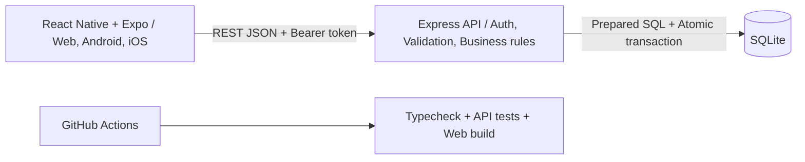
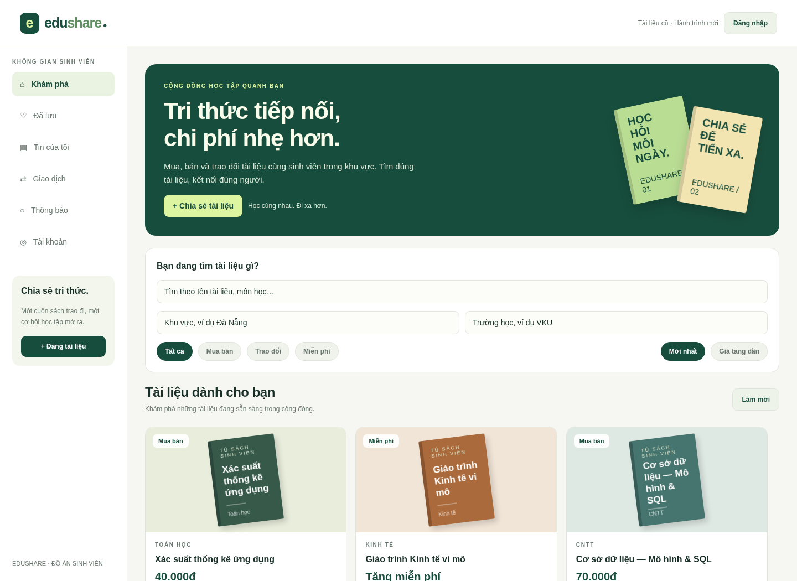
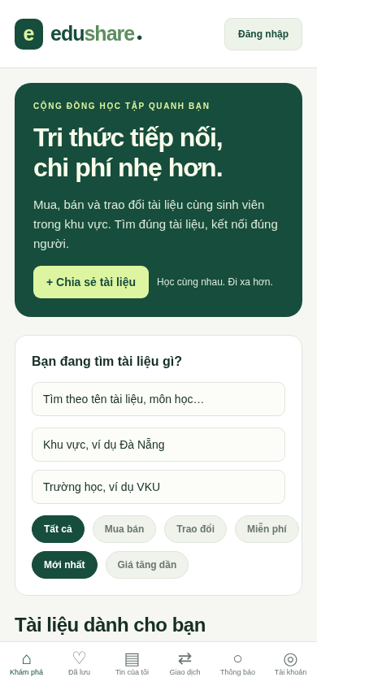
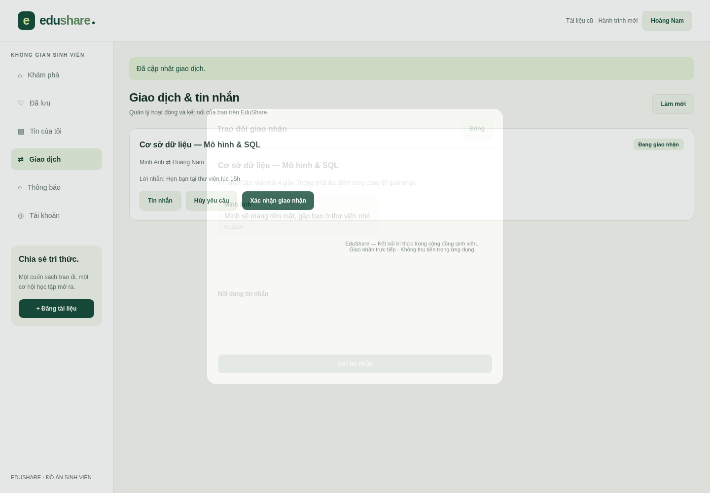
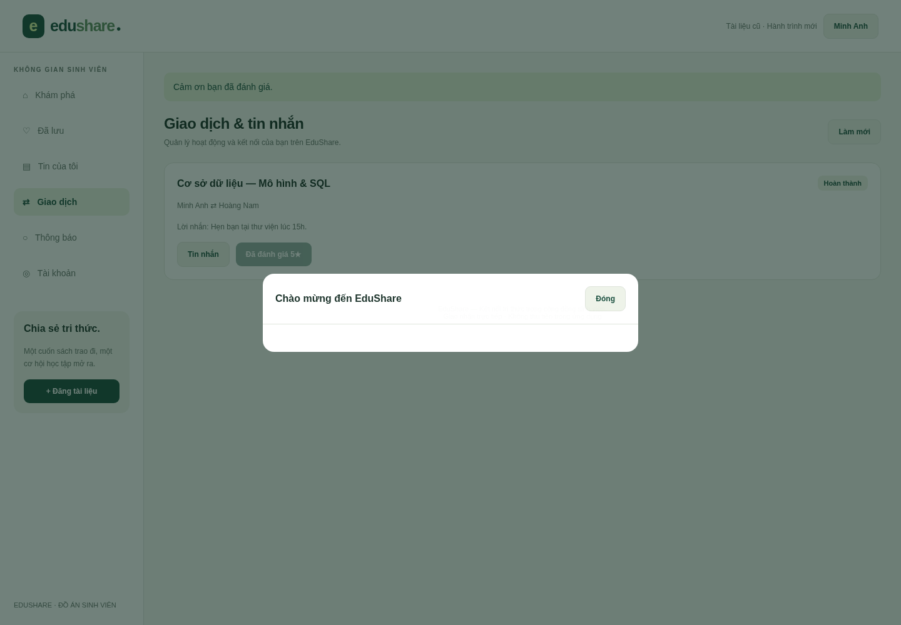

# BÁO CÁO ĐỒ ÁN

## XÂY DỰNG ỨNG DỤNG ĐA NỀN TẢNG HỖ TRỢ MUA BÁN VÀ TRAO ĐỔI TÀI LIỆU HỌC TẬP CHO SINH VIÊN TRONG KHU VỰC

Tên ứng dụng: **EduShare**

- Trường/Khoa: [Điền theo đơn vị đào tạo]
- Học phần: [Điền tên học phần]
- Sinh viên thực hiện: [Họ tên]
- Mã sinh viên: [Mã sinh viên]
- Lớp: [Lớp]
- Giảng viên hướng dẫn: [Họ tên giảng viên]
- Năm học: [Điền năm học]
- Mã nguồn: https://github.com/TanTai08/AppEduShare
- Phiên bản báo cáo: 1.0 — 10/11/2026

Thông tin cá nhân và đơn vị chưa được cung cấp nên để trống có nhãn. Nội dung mô tả đúng phạm vi MVP trong repository, không thay thế việc tự kiểm chứng và thực hiện quy định học thuật của đơn vị đào tạo.

## TÓM TẮT

EduShare là ứng dụng hỗ trợ sinh viên tìm kiếm, mua bán, trao đổi và nhận tặng tài liệu học tập bản giấy trong cùng trường hoặc khu vực. Hệ thống giải quyết các công việc đăng tin, khám phá tài liệu, gửi yêu cầu, thống nhất giao nhận, xác nhận hoàn thành và đánh giá sau giao dịch. Phiên bản đồ án sử dụng React Native với Expo và TypeScript cho giao diện dùng chung; Node.js/Express cho API; SQLite cho cơ sở dữ liệu quan hệ cục bộ.

Trọng tâm kỹ thuật là kiểm soát quyền truy cập và tính nhất quán khi nhiều người cùng yêu cầu một tài liệu. Việc kiểm tra trạng thái, giữ chỗ và hủy yêu cầu xung đột được thực hiện trong một transaction database. Giao dịch chỉ hoàn thành sau khi cả hai bên xác nhận. Kiểm thử tích hợp sử dụng HTTP thật và SQLite trong bộ nhớ; giao diện web được kiểm tra qua trình duyệt với hai phiên đăng nhập độc lập. Không tiến hành khảo sát người dùng thật hoặc đo tải quy mô lớn trong phạm vi này.

Từ khóa: React Native, Expo, TypeScript, SQLite, REST API, tài liệu học tập, trao đổi, transaction.

## MỤC LỤC

1. Tổng quan đề tài
2. Cơ sở công nghệ
3. Phân tích yêu cầu
4. Thiết kế hệ thống
5. Cài đặt chương trình
6. Kiểm thử và đánh giá
7. Triển khai, vận hành và quản lý mã nguồn
8. Kết luận và hướng phát triển
9. Tài liệu tham khảo và phụ lục

## CHƯƠNG 1. TỔNG QUAN ĐỀ TÀI

### 1.1. Bối cảnh và vấn đề

Tài liệu học tập thường được sử dụng trong một hoặc một số học kỳ, sau đó vẫn còn giá trị đối với khóa học tiếp theo. Sinh viên có thể muốn bán lại sách, đổi tài liệu theo nhu cầu hoặc tặng cho người cần. Khi thông tin được đăng rải rác trong các nhóm trò chuyện, người tìm khó lọc theo môn học, khu vực và tình trạng; người đăng phải trả lời lặp lại và dễ nhận nhiều yêu cầu cho cùng một cuốn sách.

Đề tài đưa các hoạt động này vào một ứng dụng có cấu trúc dữ liệu thống nhất. Thay vì chỉ có nội dung tin đăng, hệ thống lưu cả yêu cầu, lịch sử trao đổi và trạng thái giao nhận. Việc lưu dấu vết hỗ trợ người dùng theo dõi hoạt động và giúp quản trị viên xử lý báo cáo. Các nhận định ở đây là mô tả bài toán thiết kế; báo cáo không đưa ra tỷ lệ tiết kiệm hay kết quả khảo sát khi chưa có dữ liệu thực nghiệm.

### 1.2. Mục tiêu

- Xây dựng mã nguồn giao diện dùng chung cho web, Android và iOS.
- Cho phép tìm tài liệu theo tên, môn học, trường, khu vực và hình thức giao dịch.
- Hỗ trợ mua, nhận tặng và đổi một tài liệu lấy một tài liệu.
- Kiểm soát việc giữ chỗ để giảm xung đột khi nhiều người cùng yêu cầu.
- Cung cấp nhắn tin, thông báo trong ứng dụng, đánh giá và báo cáo vi phạm.
- Cung cấp cơ sở dữ liệu, dữ liệu mẫu, hướng dẫn VS Code và bộ kiểm thử có thể chạy lại.

### 1.3. Đối tượng và phạm vi

Đối tượng sử dụng là sinh viên có tài liệu hợp pháp cần chuyển nhượng và quản trị viên phụ trách nội dung. Phiên bản mẫu dùng Đà Nẵng và một số trường làm dữ liệu minh họa; người dùng có thể nhập khu vực/trường khác. Đây không phải hệ thống đã được trường xác nhận hoặc tích hợp dữ liệu sinh viên.

MVP chỉ xử lý tài liệu bản giấy và giao nhận trực tiếp. Không thu tiền trong ứng dụng, không cung cấp dịch vụ giữ tiền, không phân phối PDF, không xác minh tự động tư cách sinh viên. Phát hành lên cửa hàng, kiểm thử thiết bị native, khảo sát thực tế và tích hợp email là các bước riêng. Giới hạn này giúp tập trung vào luồng giao dịch và tính đúng đắn của dữ liệu.

### 1.4. Phương pháp thực hiện

Quy trình gồm xác định tác nhân và use case, thiết kế mô hình dữ liệu, triển khai API, xây dựng giao diện, kiểm thử chức năng và chuẩn bị tài liệu vận hành. Chức năng được phát triển theo các luồng hoàn chỉnh từ UI đến database. Những quy tắc quan trọng được kiểm tra ở API/database thay vì chỉ kiểm tra trên giao diện.

## CHƯƠNG 2. CƠ SỞ CÔNG NGHỆ

### 2.1. React Native và Expo

React Native mô tả giao diện bằng component và state, sau đó hiển thị qua nền tảng đích. Expo cung cấp công cụ phát triển, bundler và quy trình build. Dự án sử dụng React Native Web để hiển thị cùng component trên trình duyệt. TypeScript giúp kiểm tra cấu trúc dữ liệu trước khi chạy.

Thuật ngữ “reactive” cần được phân biệt: React cập nhật giao diện theo state, nhưng không đồng nghĩa dự án dùng reactive streams hoặc RxJS. Phiên bản này sử dụng React hooks và lời gọi HTTP bất đồng bộ. Chat được làm mới định kỳ mỗi 4 giây, không phải WebSocket thời gian thực.

### 2.2. Node.js và Express

Node.js chạy API phía máy chủ. Express tổ chức endpoint, middleware xác thực, giới hạn request và xử lý lỗi. Payload được kiểm tra bằng Zod. Helmet bổ sung header bảo vệ; CORS giới hạn origin web được đọc response theo cấu hình. CORS không thay thế xác thực và phân quyền.

Node 24 được chọn vì cung cấp API SQLite tích hợp mà mã nguồn sử dụng. Dự án không có bước biên dịch backend và không yêu cầu cài driver database native riêng. API SQLite đồng bộ phù hợp phạm vi nhỏ; tác vụ băm mật khẩu sử dụng scrypt bất đồng bộ để giảm chặn event loop.

### 2.3. SQLite và lựa chọn cơ sở dữ liệu

Các thực thể người dùng, tin đăng, giao dịch và đánh giá có quan hệ rõ ràng. Cơ sở dữ liệu quan hệ cho phép dùng khóa ngoại, unique index, check constraint và transaction để bảo vệ dữ liệu. SQLite lưu trong file, giúp giảng viên và sinh viên chạy lại dự án nhanh mà không phải cấu hình dịch vụ máy chủ database.

| Tiêu chí        | SQLite trong đồ án             | PostgreSQL khi mở rộng                             |
| --------------- | ------------------------------ | -------------------------------------------------- |
| Cài đặt         | Nhúng trong API, tự tạo file   | Cần dịch vụ và thông tin kết nối                   |
| Mô hình quan hệ | Khóa ngoại, index, transaction | Quan hệ, transaction, tính năng truy vấn phong phú |
| Ghi đồng thời   | Một writer tại một thời điểm   | Phù hợp nhiều giao dịch ghi và nhiều API instance  |
| Vận hành        | Sao lưu file nhất quán         | Backup, replication và phân quyền chuyên dụng      |
| Phù hợp         | Demo cục bộ, một instance      | Hệ thống nhiều người dùng khi đã kiểm chứng tải    |

SQLite là lựa chọn cho phiên bản đã cài đặt, thay cho đề xuất Supabase/PostgreSQL ban đầu nhằm đáp ứng yêu cầu chạy cục bộ. Không thể chuyển sang PostgreSQL chỉ bằng đổi biến môi trường; cần migration và adapter truy vấn mới.

### 2.4. GitHub và Visual Studio Code

Git lưu lịch sử mã nguồn; GitHub lưu repository và chạy CI. Lockfile cố định cây phụ thuộc cho `npm ci`. VS Code được sử dụng để sửa TypeScript/JavaScript, chạy terminal, debug API và xem database qua extension. Repository có task chạy ứng dụng và task kiểm tra toàn bộ.

## CHƯƠNG 3. PHÂN TÍCH YÊU CẦU

### 3.1. Tác nhân

| Tác nhân      | Nhiệm vụ                                                                     |
| ------------- | ---------------------------------------------------------------------------- |
| Khách         | Xem, tìm kiếm, lọc và đọc chi tiết tài liệu                                  |
| Sinh viên     | Quản lý tài khoản, tin đăng, yêu thích, giao dịch, chat, đánh giá và báo cáo |
| Quản trị viên | Xem thống kê, ẩn tin vi phạm, xử lý báo cáo                                  |

Quản trị viên vẫn sử dụng được các chức năng sinh viên. Đăng ký công khai không nhận trường role; không thể tự nâng quyền từ client. Vai trò admin demo chỉ do seed tạo trong môi trường thử nghiệm.

### 3.2. Yêu cầu chức năng

| Mã   | Yêu cầu               | Kết quả mong đợi                                        |
| ---- | --------------------- | ------------------------------------------------------- |
| FR01 | Đăng ký và xác thực   | Tài khoản mới có quyền sinh viên, phiên có hạn dùng     |
| FR02 | Cập nhật hồ sơ        | Chỉ sửa hồ sơ của mình                                  |
| FR03 | Quản lý tin đăng      | Đăng, sửa, ẩn/hiện theo quyền và trạng thái             |
| FR04 | Tìm kiếm và lọc       | Trả tài liệu active theo điều kiện                      |
| FR05 | Yêu thích             | Không lưu trùng, xem danh sách riêng                    |
| FR06 | Mua và nhận tặng      | Gửi yêu cầu cho tài liệu của người khác                 |
| FR07 | Trao đổi              | Đề nghị bằng một tài liệu exchange đang active của mình |
| FR08 | Giữ chỗ và hoàn thành | Không giữ trùng, cả hai xác nhận mới completed          |
| FR09 | Chat                  | Chỉ hai bên giao dịch truy cập được                     |
| FR10 | Đánh giá              | Chỉ sau hoàn thành và một lần mỗi bên                   |
| FR11 | Thông báo             | Chỉ người nhận được đọc/đánh dấu                        |
| FR12 | Báo cáo và kiểm duyệt | Admin ẩn tin, xử lý báo cáo, khóa việc tự hiện lại      |

### 3.3. Yêu cầu phi chức năng

- Giao diện tiếng Việt, thích ứng màn hình desktop và điện thoại.
- Mật khẩu không lưu dạng rõ; session token ngẫu nhiên và chỉ lưu hash phía server.
- API kiểm tra dữ liệu, quyền sở hữu và tư cách thành viên giao dịch.
- Truy vấn có tham số để không ghép trực tiếp dữ liệu người dùng vào SQL.
- Các thay đổi giữ chỗ có tính nguyên tử; lỗi giữa chừng phải rollback.
- Có mã lỗi và thông báo đủ để người dùng thử lại khi mất kết nối.
- Có quy trình cài đặt, dữ liệu demo, kiểm thử và build có thể lặp lại.

Chưa đặt SLA hay ngưỡng số người dùng đồng thời vì chưa có đo tải. Tính đa nền tảng ở cấp mã nguồn không thay thế nghiệm thu từng hệ điều hành.

### 3.4. Use case mua tài liệu

Tiền điều kiện: người gửi đã đăng nhập; tài liệu active và không thuộc người gửi. Luồng chính: người mua gửi yêu cầu, người đăng xem và chấp nhận, hệ thống giữ chỗ, hai bên thống nhất giao nhận qua chat, mỗi bên xác nhận, hệ thống hoàn thành và mở đánh giá.

Luồng ngoại lệ: dữ liệu không hợp lệ bị từ chối; yêu cầu lặp trả lỗi xung đột; tài liệu đã được giữ chỗ không được nhận giao dịch mới; người ngoài không được xem chat; một bên hủy trước khi hoàn thành thì tài liệu được giải phóng. Phiên bản hiện tại cho phép một bên hủy khi giao dịch vẫn accepted, kể cả sau khi bên kia đã xác nhận; cần quy trình tranh chấp chặt hơn khi vận hành thật.

### 3.5. Use case trao đổi

Người gửi chọn một tài liệu của người khác có hình thức exchange và đề xuất một tài liệu exchange active của mình. Khi người nhận chấp nhận, cả hai tài liệu được giữ chỗ trong cùng transaction. Mọi yêu cầu pending giao nhau với một trong hai tài liệu đều bị hủy. Nếu hủy giao dịch accepted thì cả hai tài liệu trở về active; nếu cả hai xác nhận thì cả hai chuyển completed.

### 3.6. Quy tắc nghiệp vụ

Không giao dịch với chính mình; không sửa tin reserved/completed; tin bị admin khóa không tự hiện lại; giá bán là số nguyên tối thiểu 1.000 VNĐ; tài liệu tặng/đổi có giá 0. Xác nhận giao nhận là khai báo của người dùng, không phải bằng chứng thanh toán. Đánh giá phải gắn giao dịch đã hoàn thành, không được đánh giá tùy ý trên hồ sơ.

## CHƯƠNG 4. THIẾT KẾ HỆ THỐNG

### 4.1. Kiến trúc ba lớp

Lớp giao diện không truy cập file database. API xác thực mọi request riêng tư, kiểm tra dữ liệu và thực hiện quy tắc nghiệp vụ. Database bảo vệ quan hệ và một số bất biến bằng constraint. Mô hình này cho phép thay giao diện hoặc database mà vẫn giữ hợp đồng API, dù chuyển database vẫn cần thay adapter.

### 4.2. Thiết kế dữ liệu

Hệ thống gồm chín bảng: users, sessions, listings, favorites, transactions, messages, reviews, reports và notifications. Khóa chính thực thể dùng UUID; phiên dùng token_hash làm khóa. Các quan hệ được mô tả chi tiết trong CO_SO_DU_LIEU.md và schema.sql.

Tin đăng lưu trường và khu vực riêng để mô tả nơi có tài liệu, có thể khác hồ sơ của người đăng. Hai trường này đang là chuỗi; chuẩn hóa thành danh mục là hướng cải tiến. reviews gắn author và target, chỉ tạo thông qua giao dịch. messages gắn transaction để giới hạn thành viên theo đúng hai bên giao dịch.

### 4.3. Thiết kế trạng thái và tính nhất quán

Tin đăng có active, reserved, completed và hidden. Giao dịch có pending, accepted, completed và cancelled. Hai cờ buyer_confirmed và seller_confirmed lưu việc xác nhận riêng. Không suy ra hoàn thành từ một phía.

Việc giữ chỗ dùng BEGIN IMMEDIATE để lấy quyền ghi trước khi kiểm tra/cập nhật. Dưới khóa ghi, hệ thống xác nhận các tài liệu vẫn active rồi chuyển reserved. Nếu có bất kỳ lỗi nào, rollback toàn bộ thay đổi và thông báo. Điều này xử lý xung đột ở tầng dữ liệu, kể cả khi người dùng gửi request ngoài UI.

### 4.4. Thiết kế giao diện

Trang chủ có thanh nhận diện, điều hướng, giới thiệu, bộ lọc và thẻ tài liệu. Desktop có sidebar; màn hình hẹp dùng thanh điều hướng dưới. Các biểu mẫu dùng modal cho xác thực, đăng tin, chi tiết, chat, báo cáo và đánh giá. Tình trạng tải, lỗi API và thông báo thao tác được hiển thị trên giao diện.

Không sử dụng ảnh tài liệu thật trong MVP: bìa được dựng từ màu và tên tài liệu. Điều này được nêu trong tài liệu để tránh hiểu nhầm rằng hình minh họa là bằng chứng tình trạng sách. Khi bổ sung tải ảnh phải kiểm tra dung lượng, MIME và chữ ký file.

### 4.5. Thiết kế xác thực và phân quyền

Mật khẩu được băm bằng scrypt với salt ngẫu nhiên. Token phiên có 32 byte ngẫu nhiên; database lưu SHA-256 token và thời điểm hết hạn. Đăng xuất xóa phiên hiện tại. Native lưu token trong SecureStore, web lưu sessionStorage để phục vụ demo.

API kiểm tra chủ tin trước sửa/ẩn, kiểm tra hai bên trước truy cập tin nhắn và kiểm tra role admin trước kiểm duyệt. Không đưa service key hoặc thông tin GitHub vào mã nguồn. Khi triển khai thật cần HTTPS và đánh giá mô hình cookie HttpOnly cho web, cùng quy trình xác minh và khôi phục tài khoản.

## CHƯƠNG 5. CÀI ĐẶT CHƯƠNG TRÌNH

### 5.1. Cấu trúc dự án

Monorepo dùng npm workspaces gồm apps/mobile và server. Thư mục mobile chứa App.tsx, api.ts và cấu hình Expo; server/src chứa ứng dụng Express, xác thực, database, SQL và seed. Kiểm thử đặt trong server/test. Tài liệu và ảnh kết quả nằm trong docs; workflow CI nằm trong .github/workflows.

Các lệnh npm chạy từ thư mục gốc giúp giảm nhầm thư mục. npm run dev khởi động cả API và Expo web; npm run db:seed tạo dữ liệu; npm run check chạy typecheck, API tests và web build. package-lock.json được commit để các máy dùng cùng cây phụ thuộc.

### 5.2. Khởi tạo và dữ liệu mẫu

Schema được chạy khi API/seed mở database, dùng CREATE TABLE IF NOT EXISTS. Seed tạo hai sinh viên và một admin demo, cùng tám tài liệu thuộc ba hình thức. Seed không xóa dữ liệu, không đổi mật khẩu tài khoản có sẵn và chỉ thêm tin mẫu khi chưa có tin nào. Đây là khởi tạo ban đầu, chưa phải cơ chế migration nâng cấp schema có version.

Đường dẫn database mặc định là server/data/edushare.sqlite. Thư mục này bị loại khỏi Git. Khi cần cấu trúc mới trong quá trình phát triển, phải dùng database mới hoặc viết migration phù hợp; không giả định CREATE TABLE IF NOT EXISTS sẽ tự thêm cột vào bảng cũ.

### 5.3. Cài đặt các module

Module tài khoản cung cấp register, login, logout và cập nhật hồ sơ. Module tài liệu cung cấp tìm kiếm, lọc, chi tiết, yêu thích và quản lý tin riêng. Tìm kiếm LIKE dùng tham số và escape ký tự wildcard; hiện chưa chuẩn hóa tìm không dấu tiếng Việt.

Module giao dịch tạo yêu cầu, giữ chỗ, hủy và xác nhận hai phía. Module chat giới hạn truy cập theo transaction; giao diện tự gọi lại mỗi 4 giây và chỉ gửi tin khi giao dịch pending/accepted. Module đánh giá kiểm tra completed và unique theo tác giả. Module quản trị hiển thị thống kê và báo cáo, ẩn tin vi phạm và hủy giao dịch mở liên quan để tránh giữ chỗ mồ côi.

### 5.4. Xử lý lỗi và giới hạn

Payload không hợp lệ trả 400; phiên sai trả 401; thiếu quyền trả 403; tài nguyên không có trả 404; xung đột trạng thái trả 409. API giới hạn JSON ở 64 KB và dùng rate limit cho đăng nhập lẫn request chung. Lỗi nội bộ được log phía server nhưng không trả chi tiết database cho client.

Client có timeout 15 giây, thông báo khi không kết nối được API. Một số cải tiến như retry có idempotency, phân trang chat, đồng bộ ngoại tuyến và quản lý reconnect chưa có. Các thao tác quan trọng cần tránh gửi lặp bằng trạng thái nút bận, nhưng tính đúng đắn vẫn dựa trên server.

### 5.5. Chạy trên máy phát triển

Clone repository, mở trong VS Code, cài Node 24, chạy npm ci, sao chép hai file .env.example thành .env, chạy npm run db:seed rồi npm run dev. Web ở localhost:8081, API ở localhost:4000. Hướng dẫn chi tiết cho Windows, Android Emulator, iOS Simulator và thiết bị thật nằm trong README.

Android Emulator dùng 10.0.2.2 để truy cập API trên máy; điện thoại thật dùng IPv4 LAN của máy trong cùng mạng. Không dùng localhost trên điện thoại để chỉ máy tính. Đổi URL API cần khởi động lại Expo vì biến EXPO_PUBLIC được đưa vào bundle.

## CHƯƠNG 6. KIỂM THỬ VÀ ĐÁNH GIÁ

### 6.1. Chiến lược kiểm thử

Kiểm thử tập trung vào kết quả quan sát được và các ranh giới quyền truy cập. API test khởi tạo SQLite trong bộ nhớ và chạy Express trên cổng tạm, sau đó dùng HTTP fetch. Cách này kiểm tra được routing, validation, auth và dữ liệu mà không làm thay đổi database phát triển.

TypeScript được kiểm tra bằng tsc --noEmit. Expo export kiểm tra khả năng đóng gói frontend web. Browser test dùng Chromium và hai browser context độc lập để thao tác giao diện như hai người dùng, tránh dùng chung phiên đăng nhập. Các ảnh trong docs/images là kết quả từ ứng dụng thực tế chạy với dữ liệu demo.

### 6.2. Nhóm ca kiểm thử

| Nhóm            | Nội dung                                                                   |
| --------------- | -------------------------------------------------------------------------- |
| Xác thực        | Đăng ký, email trùng không phân biệt hoa thường, login sai, logout thu hồi |
| Validation      | Payload sai, chặn sửa role, giới hạn tham số                               |
| Tìm kiếm        | Lọc và xử lý ký tự wildcard/chuỗi SQL như dữ liệu                          |
| Quyền sở hữu    | Chặn sửa/ẩn tin người khác, cập nhật đúng hồ sơ                            |
| Mua bán         | Chặn tự mua, yêu cầu trùng, chặn người ngoài đọc chat                      |
| Hoàn thành      | Một bên xác nhận chưa hoàn thành, không xác nhận lặp                       |
| Đánh giá        | Chỉ sau completed, mỗi bên một lần                                         |
| Cạnh tranh      | Hai yêu cầu chấp nhận chỉ một giữ được tài liệu                            |
| Trao đổi        | Kiểm tra chủ tài liệu, giữ/giải phóng hai phía, hủy yêu cầu giao nhau      |
| Quản trị        | Ẩn tin giải phóng giao dịch, khóa tự hiện, xử lý báo cáo                   |
| Thông báo/phiên | Cách ly người nhận, từ chối phiên hết hạn                                  |

Danh sách chính xác và kết quả lệnh được ghi tại KIEM_THU.md. Test cạnh tranh trên API một tiến trình chứng minh luồng đã cài đặt với SQLite; không dùng kết quả này để khẳng định hiệu năng trên nhiều máy chủ PostgreSQL.

### 6.3. Kết quả quan sát

Giao diện web tải tám tài liệu mẫu và không ghi nhận pageerror khi mở trang trên Chromium. Bố cục được kiểm tra ở viewport desktop 1440×1050 và mobile web 390×844. Kịch bản hai tài khoản thực hiện tìm tài liệu, gửi yêu cầu, chấp nhận, gửi/nhận tin nhắn, xác nhận hai phía và đánh giá thành công.

Việc kiểm tra viewport điện thoại chỉ xác nhận bố cục web trong kích thước đó, không phải bằng chứng ứng dụng đã chạy trên Android hoặc iOS. Chưa có kết quả kiểm thử native, thử tải, kiểm tra hỗ trợ người khuyết tật toàn diện hoặc khảo sát hài lòng người dùng.

### 6.4. Đánh giá và hạn chế

Ưu điểm là quy trình chạy cục bộ đơn giản, dữ liệu có ràng buộc, giao dịch có trạng thái rõ và có kiểm thử các hành vi dễ sai. Hệ thống chưa đáp ứng vận hành công khai ở quy mô lớn: giới hạn một API instance phù hợp SQLite; danh sách chưa có UI tải thêm; chat tối đa 500 tin; thiếu ảnh thật, email, xử lý tranh chấp và audit log.

Kiểm tra dependency có thể phát hiện cảnh báo từ công cụ build Expo/Metro. Các cảnh báo còn lại và cách xử lý được ghi trong KIEM_THU.md; không tuyên bố dependency không có lỗ hổng. Cần rà soát lại trước mỗi lần triển khai vì cơ sở dữ liệu advisory thay đổi theo thời gian.

## CHƯƠNG 7. TRIỂN KHAI, VẬN HÀNH VÀ QUẢN LÝ MÃ NGUỒN

### 7.1. GitHub và tích hợp liên tục

Repository sử dụng nhánh main cho bản bàn giao. Công việc tiếp theo nên tạo nhánh feature, commit có mô tả và mở pull request. Workflow chạy trên Node 24, cài npm ci, typecheck, API tests và web export; build web được tải lên artifact nếu workflow đạt. Kết quả CI trên GitHub phải xem thực tế ở tab Actions, không suy ra chỉ từ việc file workflow tồn tại.

### 7.2. Cấu hình triển khai

Frontend web là tài nguyên tĩnh nhưng API phải chạy như dịch vụ riêng. Trước khi build production, đặt EXPO_PUBLIC_API_URL thành địa chỉ API HTTPS. API cần CORS_ORIGINS khớp domain frontend, cổng phù hợp và database trên volume bền vững. Không đặt database trong thư mục bị xóa khi redeploy, không chạy seed tài khoản demo trên máy chủ công khai.

### 7.3. Sao lưu và bảo vệ dữ liệu

Phương án đơn giản cho máy cá nhân là dừng API rồi sao chép toàn bộ server/data. Nếu sao lưu khi đang chạy cần dùng API backup SQLite hoặc cơ chế nhất quán tương ứng; không chỉ copy file chính và bỏ qua WAL. Trước khi khôi phục phải dừng API, bảo quản bản hiện tại và kiểm tra dữ liệu sau khôi phục.

Không commit .env, database, session token, thông tin GitHub hay dữ liệu cá nhân thật. Khi đưa vào sử dụng thực cần chính sách lưu giữ/xóa dữ liệu, backup tự động, logging hạn chế thông tin riêng tư và quy trình tiếp nhận khiếu nại. Đây là yêu cầu phát triển tiếp, chưa được hoàn thiện trong MVP.

## CHƯƠNG 8. KẾT LUẬN VÀ HƯỚNG PHÁT TRIỂN

EduShare đã hiện thực bản MVP hỗ trợ hoạt động mua bán, trao đổi và tặng tài liệu học tập bản giấy. Kết quả bàn giao gồm mã nguồn đa nền tảng, API, schema database, dữ liệu demo, kiểm thử và tài liệu chạy bằng VS Code. Luồng giữ chỗ nguyên tử và hoàn thành hai phía thể hiện việc đưa quy tắc nghiệp vụ xuống tầng máy chủ thay vì chỉ xử lý giao diện.

Trong giai đoạn tiếp theo, ưu tiên kiểm thử trên Android/iOS, xác minh và khôi phục tài khoản, tải ảnh thật, audit log và phân trang. Khi mở rộng vận hành, cần chuyển database theo yêu cầu tải thực tế, bổ sung WebSocket hoặc SSE và thông báo đẩy. Bán tài liệu số hay thanh toán trực tuyến chỉ nên thêm khi có thiết kế quyền phân phối, kiểm soát truy cập, webhook và hoàn tiền rõ ràng.

## TÀI LIỆU THAM KHẢO

1. React Native Documentation — https://reactnative.dev/docs/getting-started
2. Expo Documentation — https://docs.expo.dev/
3. TypeScript Handbook — https://www.typescriptlang.org/docs/handbook/intro.html
4. Node.js SQLite API — https://nodejs.org/api/sqlite.html
5. Node.js Crypto API — https://nodejs.org/api/crypto.html
6. SQLite Transactions — https://www.sqlite.org/lang_transaction.html
7. SQLite Foreign Key Support — https://www.sqlite.org/foreignkeys.html
8. Express Documentation — https://expressjs.com/
9. GitHub Actions Documentation — https://docs.github.com/en/actions
10. OWASP Cheat Sheet Series — https://cheatsheetseries.owasp.org/

Các đường dẫn là tài liệu kỹ thuật để đối chiếu và đọc thêm; báo cáo không trích dẫn số liệu nghiên cứu từ các nguồn này.

## PHỤ LỤC A. HƯỚNG DẪN CHẠY

Xem README.md để có lệnh tương ứng PowerShell hoặc macOS/Linux. Thứ tự tối thiểu: clone → Node 24 → npm ci → tạo .env → npm run db:seed → npm run dev → localhost:8081. Tài khoản demo và mật khẩu chỉ dùng cho phát triển cục bộ.

## PHỤ LỤC B. MINH CHỨNG GIAO DIỆN

Ảnh được chụp từ bản web chạy cục bộ, không phải ảnh thiết kế hoặc ảnh ứng dụng native.

## PHỤ LỤC C. DANH MỤC BÀN GIAO

- Mã nguồn Expo/React Native và Express.
- schema.sql, seed.js và hướng dẫn mở database.
- Bộ kiểm thử API và workflow GitHub Actions.
- Báo cáo Markdown và Word, sơ đồ dữ liệu, tài liệu API.
- Kịch bản demo, đề cương slide, ảnh giao diện và lộ trình phát triển.

Trước khi nộp: điền thông tin cá nhân, cập nhật ảnh chạy trên máy của mình nếu trường yêu cầu, rà soát mục lục và mẫu trình bày, bổ sung phần đóng góp cá nhân thực tế.
