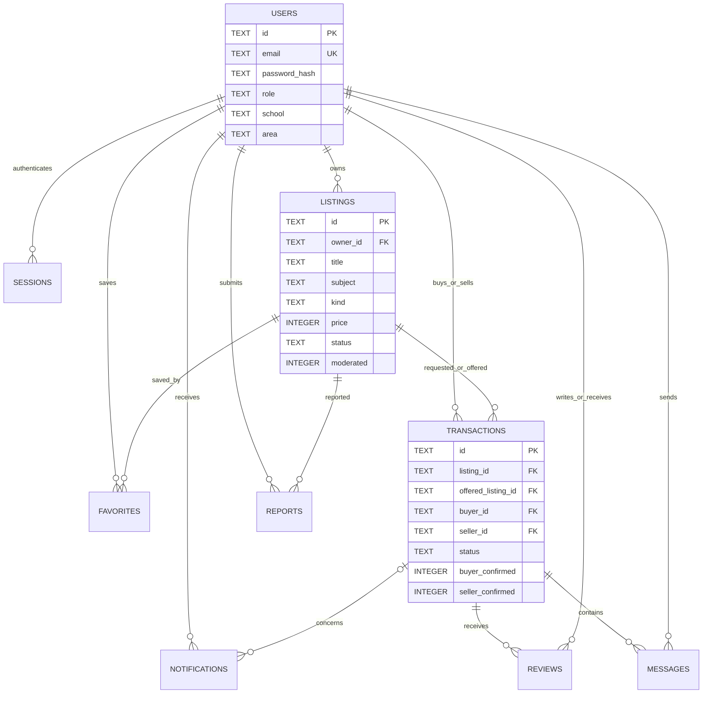
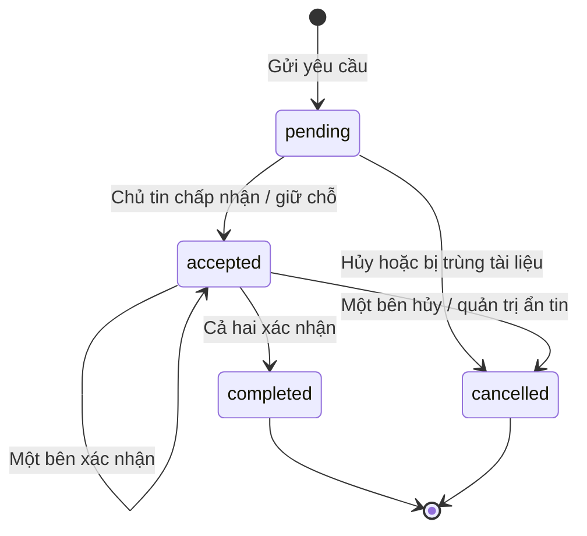

# Thiết kế cơ sở dữ liệu EduShare

## Lựa chọn và khởi tạo

SQLite là cơ sở dữ liệu quan hệ nhúng, phù hợp trình diễn offline, không yêu cầu cài dịch vụ database. Chỉ API truy cập database. Node.js 24 cung cấp `node:sqlite`; `npm run db:seed` tạo schema và dữ liệu mẫu. Nguồn chuẩn của cấu trúc là [`server/src/schema.sql`](../server/src/schema.sql).

Database lưu tại `server/data/edushare.sqlite` theo mặc định. `DB_PATH` là đường dẫn tương đối với thư mục `server` khi chạy bằng npm workspace. Không commit file database. Nếu cần database sạch, dừng API, sao lưu thư mục data, rồi chọn một `DB_PATH` mới và chạy seed; không cần xóa database cũ.

## Sơ đồ ERD



Quan hệ `offered_listing_id` có thể rỗng khi mua hoặc nhận tặng. Đổi tài liệu là một giao dịch với hai tin đăng; chủ tài liệu được hỏi là seller, người gửi đề nghị là buyer. Đây là tên kỹ thuật dùng chung cho cả ba hình thức, không hàm ý có thanh toán trong app.

## Từ điển dữ liệu

| Bảng          | Khóa và trường đáng chú ý                                                                                              | Quy tắc                                                        |
| ------------- | ---------------------------------------------------------------------------------------------------------------------- | -------------------------------------------------------------- |
| users         | id UUID, name, email, password_hash, school, area, role, created_at                                                    | Email duy nhất không phân biệt hoa thường; role student/admin  |
| sessions      | token_hash PK, user_id FK, expires_at                                                                                  | Chỉ lưu SHA-256 token; hết hạn sau 7 ngày                      |
| listings      | id UUID, owner_id FK, title, description, subject, school, area, kind, price, condition, status, moderated, created_at | Giá nguyên VNĐ, không âm; moderated khóa tin bị kiểm duyệt     |
| favorites     | user_id + listing_id PK                                                                                                | Không lưu trùng cùng một tài liệu                              |
| transactions  | id UUID, listing_id, buyer_id, seller_id, offered_listing_id, note, status, hai cờ xác nhận                            | Buyer khác seller; mỗi buyer chỉ có một yêu cầu mở cho mỗi tin |
| messages      | id, transaction_id, sender_id, body, created_at                                                                        | Chỉ thành viên giao dịch được đọc/ghi qua API                  |
| reviews       | id, transaction_id, author_id, target_id, rating, comment, created_at                                                  | 1–5 sao; unique(transaction_id, author_id)                     |
| reports       | id, reporter_id, listing_id, reason, status, created_at                                                                | open/resolved                                                  |
| notifications | id, user_id, body, transaction_id, read_at, created_at                                                                 | Chỉ chủ thông báo được xem và đánh dấu đã đọc                  |

Các trường bắt buộc được khai báo `NOT NULL` trong SQL. Mọi khóa ngoại được kiểm tra bằng `PRAGMA foreign_keys=ON`. Thời gian lưu theo UTC dạng ISO 8601, giao diện hiển thị theo múi giờ thiết bị.

## Vòng đời giao dịch



Khi chấp nhận:

1. Mở transaction SQL bằng `BEGIN IMMEDIATE`.
2. Kiểm tra người thao tác là seller, giao dịch pending và tất cả tài liệu active.
3. Đánh dấu một hoặc hai tài liệu reserved.
4. Chuyển giao dịch sang accepted.
5. Hủy các yêu cầu pending liên quan đến bất kỳ tài liệu nào vừa giữ chỗ.
6. Tạo thông báo và commit; nếu có lỗi thì rollback.

SQLite tuần tự hóa ghi trên cùng database. Vì kiểm tra và cập nhật nằm trong cùng transaction, hai yêu cầu chấp nhận không thể cùng giữ một tài liệu. Không chỉ dựa vào việc vô hiệu hóa nút giao diện.

Khi hủy accepted, chỉ trả các tài liệu reserved về active. Khi cả hai xác nhận, cả hai tài liệu trong giao dịch đổi được chuyển completed. Các yêu cầu tự hủy trước đó không tự mở lại.

## Truy vấn minh họa

```sql
-- Tài liệu đang đăng tại Đà Nẵng
SELECT title, kind, price, school FROM listings
WHERE status = 'active' AND area = 'Đà Nẵng'
ORDER BY created_at DESC;

-- Điểm uy tín theo người dùng
SELECT u.id, u.name, COUNT(r.id) AS review_count, ROUND(AVG(r.rating),1) AS rating
FROM users u LEFT JOIN reviews r ON r.target_id = u.id
GROUP BY u.id, u.name;

-- Số giao dịch theo trạng thái
SELECT status, COUNT(*) AS total FROM transactions GROUP BY status;
```

## Hiệu năng và giới hạn

- Index theo trạng thái/khu vực/trường; index tin nhắn theo giao dịch/thời gian; unique index cho yêu cầu đang mở.
- Danh sách công khai hỗ trợ limit tối đa 100 và offset. UI MVP lấy tối đa 60 tin; chưa có nút tải thêm.
- Tìm kiếm LIKE có escape ký tự `%`, `_` và dùng prepared statements; SQLite LIKE mặc định chưa bảo đảm tìm không dấu hoặc đầy đủ chữ hoa/thường tiếng Việt. Có thể bổ sung cột chuẩn hóa hoặc FTS.
- Chat hiện trả tối đa 500 tin đầu tiên; cần phân trang/cursor cho sử dụng lâu dài.
- WAL hỗ trợ đọc trong lúc ghi nhưng không biến SQLite thành hệ thống nhiều writer phân tán.

## Chuyển PostgreSQL khi mở rộng

1. Tạo migration PostgreSQL: UUID, timestamptz, enum/check và khóa ngoại.
2. Đổi adapter SQLite đồng bộ sang driver PostgreSQL bất đồng bộ.
3. Thay tham số `?` bằng `$1...`, thay hàm thời gian và cú pháp index phù hợp.
4. Khóa bản ghi tài liệu bằng `SELECT ... FOR UPDATE` theo thứ tự ID cố định.
5. Chạy lại toàn bộ kiểm thử, bổ sung test cạnh tranh trên nhiều kết nối.
6. Xuất/nhập dữ liệu có kiểm tra số lượng và quan hệ; kiểm thử backup/restore.

Không có kết nối Supabase/PostgreSQL được cấu hình sẵn trong phiên bản này.
