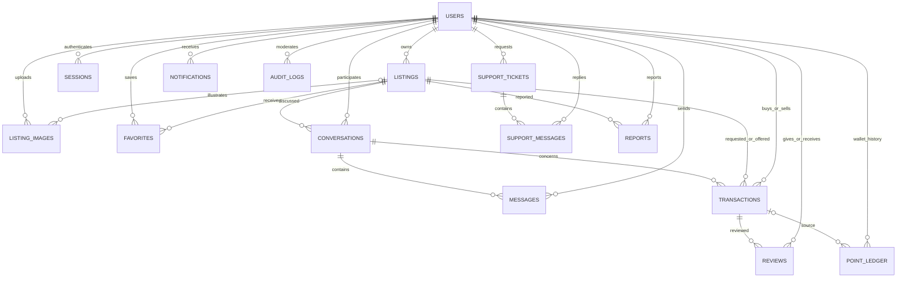

# PostgreSQL — Thiết kế và chuyển dữ liệu EduShare 2

## Nguồn chuẩn

`server/src/schema.sql` là schema PostgreSQL 17+; `src/migrate.js` áp dụng version1 và `server/migrations/002-listing-images.sql` (version2) trong bảng `schema_migrations`. Migration chạy trong transaction có advisory lock; không tự xóa bảng. Version này là khởi tạo **database PostgreSQL mới**, không phải lệnh thay đổi file SQLite.

Có **15 bảng nghiệp vụ** và bảng theo dõi migration:

| Bảng             | Nội dung và ràng buộc chính                                                             |
| ---------------- | --------------------------------------------------------------------------------------- |
| users            | UUID; email duy nhất không phân biệt hoa thường; password hash; bio; points >= 0        |
| sessions         | SHA-256 token; user; thời hạn 7 ngày                                                    |
| listings         | Chủ tin, nội dung, giá, hình thức, point_cost, trạng thái, điểm hẹn và tọa độ           |
| listing_images   | UUID; owner; listing nullable; vị trí 0–4; JPEG BYTEA, thumbnail, kích thước; FK cascade |
| favorites        | Khóa ghép user/tin, không lưu trùng                                                     |
| conversations    | Một cuộc trò chuyện theo tin và người hỏi; có thể tạo trước giao dịch                   |
| messages         | UUID, seq identity, conversation, sender, client_id; unique(sender, client_id)          |
| transactions     | Hai bên, một/hai tài liệu, conversation, snapshot giá/hình thức/điểm, xác nhận hai phía |
| reviews          | Rating 1–5; unique(transaction, author); target khác author                             |
| reports          | Báo cáo tin, người gửi, trạng thái xử lý                                                |
| notifications    | Thông báo riêng, read_at                                                                |
| point_ledger     | Delta, balance_after, reason, transaction; unique(user, transaction, reason)            |
| support_tickets  | Chủ phiếu, tiêu đề và trạng thái                                                        |
| support_messages | Trao đổi riêng giữa chủ phiếu và admin                                                  |
| audit_logs       | Người thao tác, hành động, đối tượng, thời điểm                                         |



## Điểm và giữ chỗ

Quy tắc: +10 điểm mỗi bên khi mua bán hoàn thành; nhận sách free cần 20 điểm; trừ lúc accepted và hoàn nếu cancelled. Không cộng điểm exchange/free. Mỗi cặp tối đa một lần thưởng/24 giờ; mỗi người tối đa 30 điểm/ngày UTC. Quy tắc đặt trong `domain.js` và hiển thị trên UI/FAQ.

Các chuyển trạng thái dùng PostgreSQL transaction. Advisory lock `pg_advisory_xact_lock(208811,2)` tuần tự hóa ngắn các thay đổi marketplace trên các kết nối/API dùng cùng DB. Trong transaction vẫn khóa giao dịch/tài liệu/ví khi cần. Kiểm tra điều kiện, cập nhật trạng thái, số dư, sổ điểm và thông báo nằm cùng transaction; lỗi thì rollback. Sự kiện Socket.IO chỉ phát sau commit.

Điểm không chuyển cho người cho sách: nhận sách tiêu thụ điểm, khi hủy hệ thống hoàn về người nhận. Unique ledger chống thưởng/trừ/hoàn lặp. Số dư user là bản tổng hợp; invariant kiểm thử: `users.points = SUM(point_ledger.delta)`.

Snapshot `transactions.kind/price/point_cost` giữ điều kiện lúc yêu cầu. Nếu người đăng sửa giá/hình thức khi còn pending, accept bị từ chối để người mua gửi lại. Khi một bên đã xác nhận giao nhận, người dùng không được tự hủy; admin xử lý qua hỗ trợ/kiểm duyệt. Đây chưa phải hệ thống escrow hoặc chứng nhận thanh toán ngoài đời.

## Chat và realtime

Tin nhắn gắn conversation, không phụ thuộc đã có đơn mua. REST kiểm tra thành viên trước đọc/ghi; Socket.IO xác thực token và chỉ gửi vào room do server gán theo user ID. Client không tự join room tùy ý.

Tin được lưu trước khi phát. `client_id` giúp gửi lại sau lỗi mạng không tạo trùng. `seq BIGINT` làm cursor; trả tối đa 100 tin mỗi request. UI tải 50 tin cuối, tải thêm tin cũ hoặc đồng bộ các tin sau seq cuối khi reconnect. seq được truyền dạng chuỗi để tránh mất chính xác số nguyên lớn.

Cột `buyer_read_at/seller_read_at` phục vụ số chưa đọc. Logout thu hồi phiên và ngắt socket của phiên đó; socket hết hạn được kiểm tra định kỳ. Deployment hiện dùng một Node instance; nhiều instance cần adapter/bus (ví dụ Redis), không tự có chỉ nhờ PostgreSQL.

## Vị trí và hồ sơ

Listing dùng pickup_label để ghi điểm giao nhận công khai. UI đã bỏ bản đồ và nhập tọa độ; latitude/longitude giữ lại trong schema/API để tương thích dữ liệu cũ, không còn được dùng trên màn hình. Không có bảng lịch sử GPS.

Hồ sơ public chỉ trả tên, trường/khu vực, bio, ngày tham gia, sao, số đánh giá, số giao dịch và sách active. Không trả email, password hash, session hoặc số dư. Badge “Được cộng đồng đánh giá cao” cần ít nhất 5 nhận xét, trung bình >=4,5 sao; không gọi là xác minh danh tính.

## Ảnh tài liệu (migration v2)

`listing_images` lưu chủ ảnh, tin (NULL lúc mới tải), thứ tự0–4, MIME JPEG, width/height, ảnh BYTEA và thumbnail BYTEA. Unique(listing_id,position) áp dụng khi đã gắn tin. Ảnh gốc sau chuẩn hóa tối đa2MB, thumbnail tối đa256KB; đầu vào tối đa5MB. Sharp bỏ metadata và tạo hai kích thước1600/480px. Danh sách chỉ trả metadata/URL để tránh tải BYTEA trong mỗi request.

Chủ tài khoản chỉ gắn ảnh của mình vào một tin; thay đổi tin và ảnh nằm trong cùng transaction/khóa nghiệp vụ. Ảnh đầu làm bìa, danh sách tối đa5 theo validation API; xóa khỏi danh sách khi sửa sẽ xóa dữ liệu ảnh. Ảnh chưa gắn tin chỉ chủ đọc được, giới hạn20/người; ảnh nháp quá24giờ được dọn vào lần upload tiếp theo. Ảnh đã gắn tin được đọc công khai qua URL kể cả khi tin ẩn.

Chạy `npm run db:migrate` trên database hiện có để bổ sung bảng; không xóa hoặc seed lại dữ liệu. API cũng tự migrate lúc khởi động. Sao lưu pg_dump bao gồm cả BYTEA; chưa sử dụng object storage/CDN trong phạm vi đồ án.

## Import SQLite cũ

1. Dừng API cũ, sao lưu `server/data/` nhất quán.
2. Tạo database PostgreSQL rỗng, đặt DATABASE_URL, chạy `npm run db:migrate`.
3. Chạy `npm run db:import:sqlite` từ thư mục gốc.
4. Kiểm tra số lượng, đăng nhập, lịch sử giao dịch và chat.

Nguồn mặc định là `server/data/edushare.sqlite`, mở chỉ đọc. Công cụ giữ ID/password hash, chuyển các tin nhắn theo transaction sang conversation, giữ nội dung và thứ tự thời gian. Điểm khởi tạo 0, không thưởng hồi tố. Giao dịch free đã accepted trước import không bị trừ điểm hồi tố. Các snapshot giao dịch cũ được suy ra từ tin đăng hiện có vì SQLite v1 chưa lưu snapshot; đây là giới hạn dữ liệu nguồn.

Import trong một transaction, kiểm tra database đích chưa có users và từ chối chạy lại. Không gộp tự động database đã seed. Thiếu dữ liệu hoặc lỗi FK thì rollback. SQLite nguồn không bị xóa; `server/migrations/legacy-sqlite.sql` chỉ lưu cấu trúc lịch sử phục vụ kiểm thử importer, không dùng chạy ứng dụng.

## Xem và sao lưu

Dùng pgAdmin hoặc extension PostgreSQL trong VS Code, kết nối theo `server/.env`. Schema mặc định public. Query ví dụ:

```sql
SELECT name, points FROM users ORDER BY name;
SELECT reason, delta, balance_after, created_at FROM point_ledger ORDER BY created_at DESC;
SELECT status, count(*) FROM transactions GROUP BY status;
SELECT c.id,l.title,count(m.id) FROM conversations c
JOIN listings l ON l.id=c.listing_id LEFT JOIN messages m ON m.conversation_id=c.id
GROUP BY c.id,l.title;
```

Sao lưu bằng pg_dump/pgAdmin và thử restore vào DB khác. Volume Docker giữ dữ liệu qua stop/start; `down -v` xóa volume, vì vậy không dùng để cập nhật mã. Mật khẩu compose là mẫu local, không dùng production.
